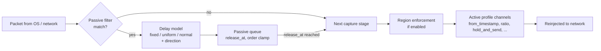

# PoC: Passive Latency (built-in artificial packet delay)

## 1. Summary

Add an always-on, profile-independent **baseline delay** to every packet matched by a filter. The delay is configurable by mode (fixed, uniform jitter, normal jitter), by value, and by direction. It is applied by `lagsw` itself, at the packet layer, so the extra latency no longer has to come from a secondary dependency: a proxy-client that sits between the game client and the server and delays traffic from outside the engine.

"Passive" means the feature needs no activation key. It runs for the whole session (optionally pausable), while the existing key-driven profiles (`from_timestamp`, `ratio`, `hold_and_send`, ...) keep working on top of it. The profiles remain the *active* manipulation; passive latency is the *ambient* connection quality they operate in.



This is a packet-scheduling feature, not a stream proxy. It does not terminate, re-originate, or modify any connection, and it never forges or edits payloads. It must only be used on traffic and endpoints the operator is authorized to intercept (see §10).

## 2. Terminology

- **Passive latency**: a delay applied to every filtered packet regardless of profile activation.
- **Baseline delay**: the per-packet delay drawn from the configured delay model, before any profile adds its own.
- **Delay model**: the function that turns a configured value into a per-packet delay (`fixed`, `uniform`, `normal`).
- **Stage**: one capture channel in the ordered chain of channels a packet passes through (passive, region enforcement, profiles). Lower backend `priority` runs first (see [packet_backend.h](../include/packet_backend.h)).
- **Proxy-client**: the external tool this feature replaces; delay is a side effect of routing through it, not something it controls. The ones operators mainly use are FlClash, Clash Forge and Proton VPN. FlClash and Clash Forge are Clash-based and route by rule, so they give fine-grained control over which traffic goes through the proxy. Proton VPN is a plain VPN with coarser routing control. In all cases the added latency comes from the physical distance and load of the chosen exit node, not from a configured value.
- **Ping / RTT**: round-trip time. A delay `d_out` on outbound and `d_in` on inbound packets adds `d_out + d_in` to the observed RTT.

## 3. Motivation

The methods in [division1_lag_switch_weapon_swap_analysis.md](../research/division1_lag_switch_weapon_swap_analysis.md) (§2 and the empirical findings in §9) depend on how withheld packets arrive relative to a state change on the server. §9 already records that the outcome is a race, not a fixed trigger, and that tuning timing improves consistency. Operators additionally observed that **a very low ping can make the methods *less* consistent**, so a better connection is not a better connection for this purpose.

Working hypothesis (unverified, to be tested in §12): with near-zero RTT the server receives the weapon-swap event and the withheld burst almost simultaneously and processes them in an order dominated by tick boundaries and scheduling noise. A stable, non-trivial baseline RTT widens and steadies the window between "swap established" and "burst resolved", which is the quantity §9 finding 1 says must scale with the withheld duration.

Today that baseline is created by routing through a proxy-client. That has costs:

- A second dependency to install, configure, keep running, and keep in sync with the profile (filters, ports, server addresses are duplicated). The usual choices are FlClash, Clash Forge and Proton VPN.
- **Latency is indirect and not tunable.** The delay comes from which exit node or region is picked, so it cannot be set to a target value, and it varies with the node's load and the route. The Clash-based clients (FlClash, Clash Forge) allow fine-grained per-rule routing, which helps scope traffic, but the delay is still whatever the node gives. Proton VPN offers much coarser routing control.
- **Cost varies.** Proxy and VPN access is usually paid, and prices and node quality differ widely by provider and plan. Reaching a given RTT can mean a specific, more expensive plan or node. Passive latency has no recurring cost and is deterministic.
- An extra hop: a second TCP/TLS handling layer with its own buffering, congestion control, and retransmission behavior, so the delay is not clean packet delay and can differ per connection.
- The delay is invisible to `lagsw`: status line, desync countdown, region enforcement, and pcap capture cannot account for it.
- It cannot be scoped by the same filter, direction, and client-address enforcement used by the profiles.

Doing it in-engine removes the dependency and lets the delay share the existing filter and capture options and the existing delayed-release machinery.

## 4. Goals

- Delay all packets matching a configurable filter by a configurable baseline.
- Support delay modes: `fixed`, `uniform` (value ± jitter), `normal` (mean, standard deviation, clamped).
- Support direction control: inbound, outbound, both, and independent values per direction.
- Reuse the profile `filter` syntax and `capture_options` semantics so one mental model applies.
- Compose with active profiles: profile delay is *added on top* of the baseline.
- Preserve packet order by default (no accidental reordering from jitter).
- Work on both backends (WinDivert and nfqueue) through [packet_backend.h](../include/packet_backend.h); no new backend primitive.
- Shut down cleanly: all queued packets are released immediately on teardown, matching the existing "deactivation flushes everything" rule.
- Be unit-testable with the fake clock and in-memory backend already used by `tests/modes` and `tests/engine`.

## 5. Non-goals

- Packet loss, duplication, corruption, bandwidth shaping (this is a delay feature, not a general netem replacement).
- Modifying packet contents or TCP sequence/ack numbers.
- Per-connection or per-flow distinct delays in v1 (one model per direction).
- Replacing active profiles, or being activated by a key in v1 beyond an optional pause toggle (§6.2).
- Adaptive "hold RTT at N ms" control (listed as a later phase, §13).

## 6. Configuration

### 6.1 Shape

A new block under `features`, following the `region_enforcement` precedent:

```yaml
features:
  passive_latency:
    enabled: true
    mode: uniform            # fixed | uniform | normal
    delay_ms: 60             # fixed: the delay; uniform/normal: the mean
    jitter_ms: 10            # uniform: +/- range; normal: standard deviation
    max_delay_ms: 250        # hard clamp after the model is sampled
    direction: both          # both | inbound | outbound
    outbound_delay_ms: ~     # optional per-direction override of delay_ms
    inbound_delay_ms: ~
    preserve_order: true     # never release a packet before an earlier one in the same direction
    filter: "tcp.SrcPort == 55000 or tcp.DstPort == 55000"   # default: global_filter
    capture_options:         # same keys as a profile's capture_options
      outbound: true
    pause_key: p             # optional: toggles passive latency off/on at runtime
    max_queued_packets: 4096
```

| Key | Required | Meaning |
| --- | --- | --- |
| `enabled` | No | Defaults to `false`. Nothing is captured when false. |
| `mode` | No | Delay model. Defaults to `fixed`. |
| `delay_ms` | If enabled | Non-negative. Fixed delay, or the mean for `uniform`/`normal`. |
| `jitter_ms` | For `uniform`/`normal` | Non-negative. Must be `0` or absent for `fixed`. |
| `max_delay_ms` | No | Upper clamp. Defaults to `delay_ms + 3 * jitter_ms`; must be >= `delay_ms`. |
| `direction` | No | Which packets are delayed. Defaults to `both`. |
| `inbound_delay_ms`, `outbound_delay_ms` | No | Override `delay_ms` for that direction. |
| `preserve_order` | No | Defaults to `true`. |
| `filter` | No | Passive capture filter in the active backend's syntax. Defaults to `global_filter`. |
| `capture_options` | No | Same semantics as profile `capture_options` (`forward`, `outbound`, `client_address_enforcement`, `server_direction`; `sniff` is rejected, see §11). |
| `pause_key` | No | Virtual key that toggles passive latency; packets queued at pause time are flushed. |
| `max_queued_packets` | No | Safety bound; see §8.4. |

Validation lives with the other option checks in `src/options/validate.cc`, and the block is added to [profiles.schema.json](../schemas/profiles.schema.json) and the README option tables. A disabled compile-time feature ignores the block with a warning, like every other optional feature.

### 6.2 Direction and RTT

An observed RTT increase is the sum of both directions. For an RTT floor of 120 ms, use `direction: both` with `delay_ms: 60`, or `outbound_delay_ms: 120` with `inbound_delay_ms: 0`. The second form leaves server-to-client latency untouched, which matters when the analysis is about *outbound* withholding (analysis §2) and inbound timing must stay realistic. Both forms must be expressible; hence the per-direction overrides.

## 7. Delay models

```
delay = clamp(sample(model), 0, max_delay_ms)
fixed   : delay_ms
uniform : delay_ms + U(-jitter_ms, +jitter_ms)
normal  : delay_ms + N(0, jitter_ms)
```

- The model is a pure function `(rng, direction) -> delay_ms` in a new `src/modules/delay_model.{h,cc}`, independent of the engine, so it can be tested deterministically with a seeded generator (`std::mt19937_64`; seed from config for tests, from `std::random_device` otherwise). This replaces the unseeded `std::rand()` style used in region enforcement.
- Delays are integer milliseconds to match `platform::tick_ms()` and `release_at` in `PacketNode`.
- Samples are clamped to `[0, max_delay_ms]`; a `normal` tail can never produce an unbounded hold.

### 7.1 Order preservation

Independent jitter per packet would reorder packets. For TCP, reordering causes duplicate ACKs and spurious fast retransmits, which interact with `retransmission_mode` (analysis §6) and pollute the measurement the feature exists to stabilise. With `preserve_order: true` the release time is clamped per direction:

```
release_at = max(now + delay, last_release_at[direction])
last_release_at[direction] = release_at
```

This behaves like a FIFO link with variable service time. `preserve_order: false` is allowed for UDP-only filters and is rejected for filters that can match TCP when the backend can determine that statically (otherwise it logs a warning).

## 8. Design

### 8.1 Placement in the engine

Model it on [region_enforcement.cc](../src/packet_engine/region_enforcement.cc): an always-on capture channel with one receive thread and one send thread over a mutex-guarded queue.

- New `src/packet_engine/passive_latency.cc`, compiled only under `LAGSW_FEATURE_PASSIVE_LATENCY`, with `start_passive_latency()`, `stop_passive_latency()`, `passive_latency_recv()`, `passive_latency_send()`, and state in `PacketEngine::State` (next to the `region_enforcement_*` members in [internal.h](../src/packet_engine/internal.h)).
- Reuse `PacketNode`, `PacketQueue`, `make_packet_node`, `collect_due_packets`, and `destroy_packet_node` from [packet_mode.h](../src/modules/packet_mode.h) rather than the ad hoc `DelayedEnforcementPacket` vector, so the queue ordering rules (release time, then receive order) are shared.
- New xmake feature entry `passive_latency` (default `true`) in the root [xmake.lua](../xmake.lua) feature table, and `add_options("passive_latency")` for the engine target and tests.

### 8.2 Stage ordering

The passive channel opens with a priority lower than every other channel so it sees a packet first and releases it into the later stages:

| Stage | `priority` |
| --- | --- |
| Passive latency | `-200` |
| Region enforcement | `-100` (existing) |
| Profiles | `0` (existing) |

Consequences, which are intended:

- A packet delayed by a profile has already been delayed by the baseline: total delay = passive + profile.
- Profile timing (`now` at capture, `release_at`, `send_all_after_delay` batch timers, `from_timestamp`) is measured from the post-passive arrival, so existing profile semantics are unchanged; only the arrival time shifts uniformly.
- On nfqueue each priority is its own nft chain with its own queue number, and a verdict (`NF_ACCEPT`) hands the packet to the next chain, so there is no re-capture loop (see §8.6 of [linux_nfqueue_backend.md](linux_nfqueue_backend.md)). On WinDivert, reinjection at priority `-200` is seen by handles with higher priority numbers only, again without a loop.

### 8.3 Receive / release

```
recv loop:   packet -> direction from PacketMeta -> delay model -> clamp/order -> push PacketNode(release_at)
send loop:   wait until earliest release_at (condition variable) -> collect_due_packets -> channel->send()
teardown:    set stopping -> flush remaining nodes immediately -> close channel
```

The send loop sleeps on a condition variable with a deadline, not a polling tick, so added error is bounded by timer resolution rather than a poll interval. Windows timer granularity must be verified (§14): a 1 ms-class precision is required for jitter values below ~15 ms to be meaningful.

### 8.4 Bounds and failure behavior

- `max_queued_packets` caps memory. On overflow the packet is released immediately (fail-open) and a rate-limited warning is logged; the feature must never become an accidental packet black hole.
- nfqueue: the kernel holds a packet until a verdict, so the queue length (`NFQA_CFG_QUEUE_MAXLEN`) must cover `max_delay_ms x peak packets/s`. Startup computes a recommended minimum from `max_delay_ms` and warns when `max_queued_packets` is below it (see §8.3 of the nfqueue PoC).
- If the capture channel cannot be opened, log an error and continue without passive latency (the same behavior as region enforcement), unless a future `required: true` key is set.

### 8.5 Runtime toggle and status

- `pause_key` toggles a flag checked in the receive loop. Pausing releases all queued packets immediately; resuming starts fresh with the clamp state reset.
- The status line ([status_line.h](../include/status_line.h)) shows a compact segment while enabled, for example `passive: 60ms +/-10 (both)` or `passive: paused`.
- A dedicated debug log group (alongside `logging::group::enforcement_packet`) records per-packet delay in debug builds only.

### 8.6 Why not extend `PacketMode`

A profile session is created and destroyed with activation and is tied to key state, `disables`, and per-profile statistics. Passive latency has none of that lifecycle. Forcing it through `PacketMode` would require a permanent pseudo-profile that must be excluded from `disables: "*"`, status counters, pcap naming, and the desync countdown. A separate always-on stage with shared node and queue helpers is smaller and keeps the profile code untouched. The alternative, a single in-process pipeline where the passive delay is a step inside each profile's `capture()`, avoids opening a second channel but changes every mode; it is recorded as an open question (§14).

## 9. Interaction with existing features

- **Profiles.** Additive, as in §8.2. Profile `delay_ms` values keep their meaning ("extra delay beyond baseline"). Docs and the `div1.sw.yml` comments must say so, so existing tuned values are not mistaken for absolute RTT.
- **Region enforcement and latency probes.** Probe traffic measures real latency to servers (see [division1_server_list_and_latency_probes.md](../research/division1_server_list_and_latency_probes.md)). The default passive filter must exclude the configured `probe_port` UDP traffic, and discovery/forwarded-address sniffers are unaffected because they use `sniff` and their own filters; this must be asserted in tests so a baseline delay does not skew region detection.
- **Desync countdown.** Its estimate is based on profile active duration; baseline delay does not change that duration, but the doc should state that the estimate excludes baseline.
- **Retransmission filtering.** Order-preserving delay does not itself create duplicates. Large baselines combined with jitter can exceed the endpoint's RTO and cause genuine retransmissions; the validator warns when `max_delay_ms` (summed over directions) exceeds a conservative 200 ms.
- **pcap files.** Pcap captures happen per profile session, so they show post-passive arrival times. Documented, not changed.
- **Proxy-client (FlClash, Clash Forge, Proton VPN).** Not required, and mutually redundant. When both are used the delays stack, and the proxy's exit-node latency is not visible to `lagsw`, so the README migration note should say to route the game directly (or use a DIRECT rule) and remove the proxy-client delay. Passive latency is also compatible with a proxy or VPN that is kept for other reasons (such as region access): the baseline is applied on top of the tunnel, and filters must match the tunnel interface's addresses and ports as `lagsw` sees them (the existing `inbound`/`outbound` interface options already cover this case; see `forwarded_address_discovery` in [div1.sw.yml](../profiles/div1.sw.yml)).

## 10. Security and correctness requirements

- Off by default (`enabled: false`); never enabled implicitly by a profile.
- Startup logs the effective configuration (mode, values, direction, filter) once so a delayed connection is never a mystery.
- Delay is clamped (`max_delay_ms`), queue is bounded, teardown always flushes. A crash must not leave a ruleset behind (nfqueue table lifecycle is already owned by the backend).
- Packet bytes are forwarded unmodified; no checksum recomputation is needed.
- The default filter is the same narrow `global_filter` as profiles, never "all traffic". A filter that matches everything requires an explicit `filter` and logs a warning.
- Scope follows [division1_lag_switch_weapon_swap_analysis.md](../research/division1_lag_switch_weapon_swap_analysis.md) §10: for authorized interception on one's own traffic, for research and defensive-detection work. This document does not describe targeting live infrastructure.

## 11. Rejected or restricted options

- `capture_options.sniff: true` is rejected for passive latency: a sniff copy cannot be delayed, so the setting would silently do nothing.
- Negative delays are rejected; this feature cannot make traffic faster.
- `preserve_order: false` on a filter that can match TCP is a warning (see §7.1).

## 12. Test plan

### Unit (`tests/modes`-style, fake clock)

- `fixed`: every packet released at exactly `now + delay_ms`.
- `uniform`/`normal` with a fixed seed: samples within `[0, max_delay_ms]`, mean and spread within tolerance over N samples.
- `preserve_order`: for any jitter sequence, release order equals receive order; with `false`, reordering is allowed.
- Per-direction values: inbound and outbound use their own model and independent clamp state.
- Clamp: a `normal` sample far above `max_delay_ms` is capped.

### Engine (`tests/engine`, in-memory backend)

- Passive-only: all filtered packets delayed, non-matching packets untouched.
- Passive + `from_timestamp` profile: total delay = passive + profile.
- Passive + `hold_and_send`: released packets are still baseline-delayed once, never twice.
- Pause key flushes queued packets; resume delays new packets only.
- Teardown flushes everything and leaves no leaked `PacketNode`.
- Queue overflow fails open, logs once per interval.
- Probe-port traffic is not delayed when region enforcement is enabled.

### Options (`tests/options`)

- Schema and validator: negative values, `jitter_ms` with `fixed`, `max_delay_ms < delay_ms`, `sniff: true`, unknown `mode`/`direction`, feature disabled at compile time.

### Backend

- Localhost harness ([scripts/test_nfqueue_localhost.sh](../scripts/test_nfqueue_localhost.sh)): measured RTT through the gateway test shows the configured floor within tolerance; clean nft table removal after exit.
- WinDivert: manual check with a ping/UDP echo and the timing capture, since CI has no Windows driver.

### Hypothesis check (the motivating claim)

Run the weapon-swap procedure over N attempts at three baselines (native RTT, mid, high) with the passive floor, and compare consistency against the same attempts routed through the proxy-client. This validates §3 and confirms the in-engine delay is at least equivalent to the proxy-client for this purpose. Record results in the research doc.

## 13. Suggested implementation phases

### Phase 0: delay model

`delay_model.{h,cc}` with `fixed`/`uniform`/`normal`, clamp, seeded RNG, and unit tests. No engine changes.

### Phase 1: single-direction fixed delay

Feature flag, config block, schema, validation, `passive_latency.cc` with a `fixed` delay, `direction: both`, queue bounds, teardown flush, engine tests.

### Phase 2: modes, direction, order

`uniform`/`normal`, per-direction overrides, order clamp, status line segment, startup log.

### Phase 3: runtime control and composition

`pause_key`, probe-port exclusion, profile composition tests, README and `div1.sw.yml` documentation, migration note away from the proxy-client.

### Phase 4: adaptive target RTT (optional)

`mode: target_rtt` measures the unmanipulated RTT from observed TCP seq/ack timing and pads each packet so the observed RTT holds near a target, turning "low ping is worse" into a single configurable floor regardless of the player's real connection.

## 14. Open questions

- Windows timer resolution: is `platform::tick_ms()` and the send-loop wait granular enough (<= 1 ms)? If not, the release loop needs a high-resolution waitable timer (and `timeBeginPeriod`) on that platform.
- Separate channel versus in-process stage: does the extra capture/reinject round trip add measurable fixed latency on nfqueue that should be subtracted from the configured delay, or is the in-process pipeline worth the invasiveness (§8.6)?
- Should `delay_ms` be absolute RTT contribution (`direction: both` splits it in half) instead of per-direction value, to match how operators think about "ping"?
- Should profiles be able to opt out of the baseline (for example a profile that must act on raw arrival times)? This would need a per-profile marker or a second filter exclusion.
- Is `target_rtt` (Phase 4) wanted, given it needs reliable RTT estimation for UDP flows, which have no seq/ack?
- Does a baseline delay need to be reflected in the desync countdown estimate, or only documented?
