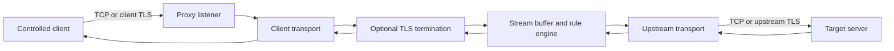

# PoC: TCP/TLS Proxy with Application-Data Filtering

## 1. Summary

Build a user-space TCP relay for server traffic that can make filtering decisions on reassembled application data, including plaintext exposed by a TLS termination point. The relay accepts client connections either via an explicit local/server-facing listen address or via network-level redirection (transparent proxying where traffic targeting remote server IP/ports is overridden and redirected into the proxy). It optionally terminates TLS, applies ordered content rules to the byte stream, and opens a separate upstream TCP/TLS connection to the real destination.

This PoC is intentionally a stream proxy, not a direct extension of the existing WinDivert packet engine. WinDivert can match packet headers and individual payload bytes, but it does not reassemble an ordered TCP stream or decrypt TLS. However, WinDivert or Windows Filtering Platform (WFP) rules can serve as the network-level interception mechanism that redirects connection attempts into the proxy without client application modification.

The PoC must only be used for traffic and endpoints for which the operator is authorized to intercept and decrypt data. It must not attempt to bypass certificate validation or silently decrypt arbitrary third-party connections.

## 2. Problem and motivation

The current application delays, drops, and releases packets selected by WinDivert filters. Its filter inputs are packet-level values such as source/destination address, port, TCP flags, payload length, and payload bytes. This is sufficient for network simulation but insufficient for rules such as:

- block a request containing a particular application command;
- delay a response with a particular message type;
- reject a session after a protocol-level error;
- allow only a selected tenant, route, or operation in an encrypted protocol;
- inspect a complete length-prefixed message that spans multiple TCP segments.

TCP segmentation, retransmission, out-of-order delivery, buffering, and TLS record boundaries make packet-local matching unreliable. A TLS ciphertext packet also does not contain searchable application text. The relay must therefore operate on a logical stream or message boundary, not on individual packets.

## 3. Goals

The first PoC should demonstrate the complete path for one controlled TCP/TLS protocol:

1. Accept a client TCP connection.
2. Optionally perform server-side TLS termination using a configured certificate and private key.
3. Connect to the configured upstream server using TCP and, when enabled, upstream TLS.
4. Read both directions into bounded buffers.
5. Reassemble enough bytes to evaluate content rules across TCP and TLS record boundaries.
6. Apply a deterministic action: allow, drop, delay, close, or log.
7. Forward allowed bytes without changing their application-level representation.
8. Emit counters and structured logs that make each decision explainable.
9. Shut down cleanly without leaking sockets, TLS objects, or buffered data.

The PoC should support these access modes:

- **Explicit endpoint relay:** TCP/TLS proxy where clients connect explicitly to the proxy's designated address and port.
- **Network-level transparent proxy:** Inline redirection where client traffic sent to existing server IP/ports is overridden via network routing (WinDivert packet/flow redirection, WFP, or DNS override) and redirected to the proxy listener without modifying client endpoint configuration.
- **Plain or TLS-terminated stream relay:** Plaintext TCP to TCP, or client TLS termination with optional re-encryption to the upstream server.

## 4. Non-goals

The PoC does not initially attempt to:

- decrypt TLS without client trust configuration (e.g. installing a local root CA or configuring client trust stores);
- bypass TLS certificate pinning or Encrypted Client Hello (ECH) implemented in target applications;
- support every TLS version, cipher, ALPN protocol, or application protocol;
- provide an automated enterprise CA or public ACME certificate issuance service;
- infer message boundaries for an unknown protocol without a protocol framer;
- replace the existing packet-level delay/drop modes in `PacketEngine`;
- provide high availability, clustering, user authentication, or an external management API;
- inspect encrypted bytes without terminating TLS and claim it provides stream-level filtering.

## 5. Existing-code fit

The repository already has a clear packet-processing abstraction:

- `PacketEngine` owns WinDivert handles, packet receive/send threads, and lifecycle.
- `PacketMode::capture` receives one packet at a time and queues `PacketNode` objects.
- Profile filters are compiled as WinDivert expressions and operate at the network layer.
- The current Windows build uses C++20 and embeds the WinDivert runtime.

The proxy should initially be a separate component, for example `pocs/tcp_tls_proxy/`, with its own executable and configuration. Reusing `PacketMode` would obscure an important semantic difference: packet modes can delay or drop packets, while a stream proxy must preserve TCP ordering, flow control, and application framing. A later integration can share logging, profile parsing, or rule vocabulary after the standalone behavior is proven.

## 6. Proposed architecture



### 6.1 Components

**Listener & Interception Adapter**

- Binds an explicit local address and port (e.g. `127.0.0.1:56000`).
- Accepts connection attempts and assigns a connection ID.
- Supports two connection discovery modes:
  - **Explicit mode:** Upstream server address is statically configured or determined via proxy settings.
  - **Network-level transparent mode:** Upstream server address is resolved per connection by querying an original-destination state table populated by the network redirection layer (e.g., WinDivert or WFP driver).
- Applies an allowlist for client addresses if configured.
- Creates one bidirectional session object per accepted connection.

**Network Redirection Engine (Transparent Mode)**

When operating as a network-level proxy, connection routing to external servers is overridden and redirected locally:
- **Redirection methods:**
  1. *WinDivert L3/L4 NAT:* Intercepts outbound TCP SYN packets matching destination filter rules (e.g. `tcp.DstPort == 55000`) and rewrites the destination IP:port to `127.0.0.1:proxy_port`.
  2. *Windows Filtering Platform (WFP) App/Socket Redirect:* Redirects connect calls at the transport/socket layer before packet emission.
  3. *DNS / Hosts Override:* Maps server hostnames in `C:\Windows\System32\drivers\etc\hosts` or local DNS to loopback, directing standard TCP socket connections to the proxy.
- **Original Destination Tracking:**
  - Maintains a lookup map: `(client_ip, client_port) -> (original_dst_ip, original_dst_port)`.
  - When WinDivert or WFP intercepts a new TCP SYN, it records the original target tuple before rewriting packet headers.
  - When the listener accepts a redirected socket, it queries this table using the client socket's peer port to determine the real target upstream endpoint.
- **Routing Loop / Self-Interception Avoidance:**
  - Outbound TCP connections initiated by the proxy process itself must be excluded from redirection filters (e.g., WinDivert filter expression `outbound and processId != proxy_pid` or process ID bypass flags). Without this, the proxy's upstream `connect()` call would loop back into its own listener.

**Transport adapters**

- `TcpTransport`: nonblocking socket read/write with bounded send and receive buffers.
- `TlsTransport`: TLS state machine layered over a TCP transport.
- Each direction has independent read, write, and shutdown state.

**TLS manager**

- Loads a configured server certificate and private key for static client-facing TLS termination, or uses a local Root CA to dynamically generate certificates matching the target host's SNI (Server Name Indication) in transparent proxy mode.
- Optionally validates the upstream certificate using the OS or configured trust store.
- Inspects `ClientHello` SNI to select or mint server certificates and determine upstream hostnames when DNS/IP redirection is active.
- Exposes decrypted bytes only to the rule engine and never logs raw application data by default.

**Stream buffer**

- Maintains an ordered byte buffer per direction.
- Handles partial reads and writes, including a message split over many reads.
- Retains an overlap window so rules can match tokens split across evaluation boundaries.
- Enforces maximum buffered bytes and maximum time waiting for a complete message.

**Protocol framer**

- Converts a byte stream into filterable units when the protocol has a known framing format.
- The first adapter can support one documented test protocol, such as a 4-byte big-endian length prefix followed by a UTF-8 or binary message.
- A raw-stream fallback can evaluate bounded rolling windows, but it must not pretend that arbitrary byte matches are message-aware.

**Rule engine**

- Evaluates rules against direction, connection metadata, message bytes, and optional decoded fields.
- Returns one explicit action and a rule ID.
- Does not perform socket I/O, TLS operations, or unbounded buffering.

**Session controller**

- Coordinates both directions, rule decisions, delayed releases, half-close behavior, and fatal errors.
- Records state transitions and ensures one cleanup path for every exit.

**Metrics and logging**

- Counts accepted, rejected, active, completed, and failed connections.
- Counts bytes and messages in each direction.
- Counts rule matches by rule ID and action.
- Logs metadata such as connection ID, direction, rule ID, and lengths; payload logging is opt-in and redacted by default.

## 7. TLS model

TLS does not make plaintext available merely because the proxy sees packets. The proxy must be an active endpoint in the TLS connection on both sides.

### 7.1 Client-facing TLS

Client-facing TLS termination depends on the interception access mode:

- **Explicit mode (fixed certificate):** The proxy presents a pre-configured server certificate and key matching a specific hostname or IP address.
- **Network-level transparent mode (dynamic CA certificate generation):**
  - When network routing overrides arbitrary target host IP/ports, the client expects a certificate matching the domain it attempted to contact (e.g. `game.example.test`).
  - The proxy inspects the unencrypted `ClientHello` packet payload during the initial handshake to extract the requested **SNI (Server Name Indication)** hostname.
  - Using a pre-generated local **Root Certificate Authority (Root CA)** installed in the host client system's trusted root store, the proxy dynamically generates and signs an in-memory X.509 leaf certificate for the extracted SNI hostname.
  - Subsequent connections to the same host reuse cached leaf certificates to reduce handshake overhead.

### 7.2 Upstream TLS

The proxy opens a separate TLS connection to the real upstream server:
- In explicit mode, the upstream server address and SNI are taken from static configuration.
- In network-level transparent mode, the upstream target address is derived from the original destination lookup map, and the upstream SNI header is copied directly from the client's `ClientHello` SNI extension.
- Upstream certificate and chain verification are enabled by default using the operating system trust store or a specified CA bundle.

### 7.3 TLS and network interception limitations

- **Certificate Pinning:** If target client applications enforce strict public key pinning (e.g., hardcoded SHA-256 cert hashes), transparent TLS decryption will be rejected by the client during handshake.
- **Encrypted Client Hello (ECH):** In TLS 1.3 setups using ECH, the SNI extension is encrypted with the real server's public key before the client sends it. The proxy cannot inspect ECH SNI without the server's private key, falling back to IP-based routing or connection failure.
- **Mutual TLS (mTLS):** If the server requires client certificate authentication, the proxy cannot complete the upstream handshake without access to the client's private key.
- **Identity preservation:** The upstream server sees TLS connections originating from the proxy host, not the original client IP, unless protocol-level proxy headers (e.g. PROXY protocol v2) or explicit IP spoofing are supported.
- Filtering TLS ciphertext without termination is impossible for application data inspection; session keys must be held by the proxy endpoint.

## 8. Rule and configuration design

Use a small, explicit configuration for the PoC. The proxy supports both explicit endpoint proxying and network-level transparent interception:

### 8.1 Transparent Network Redirection Configuration

```yaml
interception:
  mode: transparent_windivert # Mode: explicit | transparent_windivert | hosts_override
  listen_address: 127.0.0.1
  listen_port: 56000
  windivert_filter: "outbound and tcp.DstPort == 55000 and ip.DstAddr != 127.0.0.1"
  bypass_process_id: true # Automatically append processId != proxy_pid to prevent loops

tls:
  client_facing:
    mode: dynamic_ca # Mode: static_cert | dynamic_ca
    ca_certificate: test-certs/proxy-root-ca.crt
    ca_private_key: test-certs/proxy-root-ca.key
  upstream:
    mode: original_destination # Connect to original intercepted IP:port
    verify_certificate: true

protocol:
  framing: u32be_length_prefix
  max_message_bytes: 1048576
  max_buffer_bytes: 4194304

rules:
  - id: block-admin-command
    direction: client_to_server
    match:
      field: command
      equals: ADMIN_RESET
    action: close

  - id: delay-selected-response
    direction: server_to_client
    match:
      field: event
      equals: ROUND_STARTED
    action:
      type: delay
      milliseconds: 500
```

### 8.2 Explicit Proxy Configuration

```yaml
interception:
  mode: explicit
  listen_address: 127.0.0.1
  listen_port: 56000

upstream:
  address: game.example.test
  port: 55000
  tls:
    enabled: true
    server_name: game.example.test
    verify_certificate: true

tls:
  client_facing:
    mode: static_cert
    certificate: test-certs/service.crt
    private_key: test-certs/service.key

protocol:
  framing: u32be_length_prefix
  max_message_bytes: 1048576
  max_buffer_bytes: 4194304

rules:
  - id: observe-heartbeat
    direction: both
    match:
      field: command
      equals: HEARTBEAT
    action: log
```

Rules must be ordered and deterministic. The first matching rule wins. If no rule matches, the default action is `allow`.

Recommended initial match types:

- exact field equality after protocol decoding;
- bounded byte-prefix or byte-substring match;
- numeric comparison on a decoded field;
- direction and connection metadata predicates (including original destination IP/port and SNI domain name).

Avoid a general-purpose expression language in the first PoC. It would create a second parser and make security review harder before stream semantics are validated.

## 9. Action semantics

**Allow** forwards the complete framed unit in order.

**Log** forwards the unit and records metadata. It must not log payload bytes unless an explicit debug setting is enabled.

**Drop** consumes the unit and sends no replacement. The protocol-specific consequence must be documented because the peer may wait indefinitely.

**Delay** retains the unit for a bounded duration before forwarding it. Delays apply to framed units, not arbitrary packets, and the buffer limit remains active during the delay.

**Close** sends a protocol-appropriate error if one exists, then closes the affected session. The PoC should distinguish a rule rejection from a transport failure in logs and metrics.

The first implementation should not silently rewrite sequence numbers, retransmit data, or manufacture TCP acknowledgements. The operating system TCP stacks on each side of the proxy handle those concerns independently.

## 10. Data-flow and state machine

For each accepted connection:

1. Create a session ID and capture peer/local socket addresses.
2. In transparent mode, query the network redirection engine's original destination table using the client socket's peer port to find `(original_dst_ip, original_dst_port)`.
3. Establish the upstream TCP connection to the target server with a connection timeout (excluding the proxy's process ID from network redirection rules to prevent loops).
4. Inspect initial bytes if TLS is enabled:
   - Extract SNI hostname from client `ClientHello`.
   - In dynamic CA mode, retrieve or generate a matching leaf certificate.
5. Complete client-side and upstream TLS handshakes.
6. Read bytes from either side when that side is ready.
7. Feed bytes through the appropriate TLS adapter and stream buffer.
8. Extract complete protocol frames subject to `max_message_bytes`.
9. Evaluate rules in the direction of travel.
10. Queue allowed or delayed frames for the opposite transport.
11. Drain writes while respecting backpressure.
12. Propagate orderly half-closes after buffered data is flushed.
13. On protocol, TLS, timeout, limit, or transport error, close both sides, purge the state map entry, and record the reason.

A simple session state model is:

```text
Accepted
  -> ResolvingOriginalDestination
  -> ConnectingUpstream
  -> HandshakingClient (SNI / Dynamic Cert) / HandshakingUpstream
  -> Relaying
  -> Draining
  -> Closed
```

Any state can transition to `Closed` on a fatal error. A client handshake failure must not be reported as an upstream server failure, and vice versa.

## 11. Buffering, backpressure, and correctness

The proxy must treat memory limits as part of the protocol contract:

- `max_message_bytes` limits a single framed message.
- `max_buffer_bytes` limits queued data per direction and per session.
- `max_connections` limits concurrent sessions.
- `connect_timeout`, `handshake_timeout`, `idle_timeout`, and `action_delay_max` limit time spent in each phase.
- When a destination is slow, stop reading from the source rather than growing an unbounded queue.
- When a frame is delayed, continue enforcing the total buffer limit.
- Never forward bytes from a later frame before an earlier frame in the same direction.
- Preserve binary bytes exactly; do not assume UTF-8 unless the protocol definition says so.
- Treat malformed framing as a protocol error, not as a reason to scan unbounded input.

Use a single-threaded event loop for the first PoC if the selected Windows networking library supports it. A small number of worker threads is acceptable, but the ownership of each session and its buffers must remain clear. The existing packet engine's receive/send thread model should not be copied without a need for packet-level parallelism.

## 12. Security and privacy requirements

- **Loopback binding:** Bind listener sockets to explicitly configured local addresses (e.g. `127.0.0.1`); avoid binding to `0.0.0.0` unless explicitly requested.
- **Self-Interception Loop Prevention:** Network redirection rules must filter by process ID (`outbound and processId != proxy_pid` or WinDivert process bypass flags) so outbound proxy connections to real servers never get re-diverted into the proxy itself.
- **Original Destination State Table Lifecycle:** Entries in the `(client_ip, client_port) -> original_dst` lookup map must be explicitly expired and removed after a short timeout (e.g., 10 seconds) or when connection setup completes, preventing memory leaks from SYN scans or aborted handshakes.
- **Local Root CA Key Security:** The private key of the local Root CA used for dynamic certificate generation must be stored securely with restricted file ACLs, and the Root CA certificate installation/uninstallation in the Windows Certificate Store (`certlm.msc`) should be handled cleanly with user authorization.
- **Upstream Validation:** Validate upstream certificates and hostnames against the OS/configured trust store by default.
- **Payload Redaction & Privacy:** Do not log plaintext payloads by default. If payload logging is enabled for debugging, enforce strict byte limits and redact sensitive fields (credentials, session tokens).
- **Visibility:** Explicitly log TLS termination, dynamic SNI certificate generation, and network redirection status at application startup.
- **Memory Safety:** Enforce `max_message_bytes` and `max_buffer_bytes` before allocating frame buffers to defend against memory exhaustion attacks.
- **Clean Shutdown:** Unregister WinDivert/WFP network redirection rules, close listener sockets, drain active session queues, and destroy TLS contexts cleanly on termination.

## 13. Suggested implementation plan

### Phase 0: prove the environment

- Select a test protocol with a known frame format (e.g. 4-byte length prefix).
- Generate a local test CA, server certificate, and client trust configuration.
- Build a tiny client and upstream test server that can send split frames, coalesced frames, binary data, and deliberate delays.
- Decide on the TLS library for the C++20 build (Schannel or OpenSSL).

### Phase 1: explicit plain TCP relay

- Add a standalone PoC executable under `pocs/tcp_tls_proxy/`.
- Implement listener, static upstream connect, bidirectional copying, limits, timeouts, and clean shutdown.
- Add the protocol framer and an allow/log/close rule engine.
- Test messages split across reads and multiple messages received in one read.

### Phase 2: static TLS termination & stream rules

- Add client-facing static TLS termination and upstream TLS with certificate/hostname verification.
- Test handshake failures, certificate failures, partial TLS records, and orderly shutdown.
- Confirm that rule matches operate on decrypted bytes and that ciphertext never reaches the rule engine.

### Phase 3: network-level transparent interception & dynamic CA

- Implement WinDivert packet/flow redirection and original destination tracking (`(client_ip, client_port) -> original_dst`).
- Implement process ID exclusion (`processId != proxy_pid`) in WinDivert filters to prevent self-interception loops.
- Implement SNI parsing from client `ClientHello` messages.
- Implement dynamic leaf certificate generation using the local Root CA for transparent TLS interception.

### Phase 4: delay and operational visibility

- Add bounded framed-message delays.
- Add counters, rule IDs, connection IDs, and reason-coded close events.
- Add configuration validation and startup checks for certificate/key paths.
- Add a test-only payload trace with strict byte and field redaction.

### Phase 5: evaluate repository integration

Only after the standalone PoC is reliable, decide whether to share:

- logging primitives;
- configuration loading;
- server selection and profile activation concepts;
- rule and action naming.

Do not merge proxy stream logic into `PacketMode` merely to reuse profile names. If integration is desired, introduce a separate `TransportMode` or `ProxyEngine` abstraction with a clear stream-level contract.

## 14. Test plan and acceptance criteria

### Functional tests

- **Explicit mode:** Plain TCP allow path forwards bytes byte-for-byte; static TLS termination succeeds with trusted certs.
- **Transparent network mode:** Outbound connection to override IP:port is redirected by WinDivert/hosts override, original destination is correctly resolved, and traffic reaches the true upstream host.
- **Self-interception loop prevention:** Proxy's outbound connection to upstream does not trigger redirection rules back into the proxy.
- **Dynamic TLS SNI:** Client `ClientHello` with SNI `game.example.test` receives a dynamically minted certificate signed by the proxy's Root CA.
- **Stream rule matching:** A rule matches a message split across at least three TCP reads or crossing a TLS record boundary.
- **Message ordering:** Multiple frames in one read are evaluated independently and remain ordered.
- **Action semantics:** Delay action delays frame release without corrupting stream framing; Close action terminates session on rule violation.

### Failure and limit tests

- Invalid certificate, key, CA, and upstream hostname fail at startup or handshake with actionable errors.
- Unmapped client connections in transparent mode drop or close gracefully.
- Upstream refusal and timeout close the client without hanging.
- Malformed length prefixes and oversized frames are rejected before memory allocation.
- Slow readers apply backpressure and do not grow memory without limit.
- Client and upstream half-closes drain correctly.
- Abrupt resets free all session resources and remove state map entries.
- Redirection rules are cleaned up on shutdown.

### Acceptance criteria

The PoC is successful when:
1. A client attempts to connect to an external server IP/port overridden at the network level via routing/WinDivert rules.
2. The proxy redirects the connection, queries the original destination, inspects the SNI, dynamically generates a matching TLS certificate, and establishes an upstream TLS session.
3. Decrypted framed messages split across TCP/TLS boundaries are matched against stream content rules, and configured actions (allow/delay/close) execute deterministically without memory or socket leaks.

## 15. Risks and open decisions

**Routing loops / Self-interception:** If the proxy process fails to exclude its own process ID (`processId != proxy_pid`) from network redirection rules, its outbound connection to the target server will be re-diverted into its own listener, causing infinite connection loops and stack/socket exhaustion.

**Original destination map leaks:** If client connection attempts are aborted mid-handshake or port allocation is reused rapidly, the original destination lookup table can leak memory or misroute connections. State map entries must have strict timeouts and TTLs.

**Certificate Pinning & ECH:** Transparent proxying cannot decrypt TLS traffic if the client application uses Encrypted Client Hello (ECH) or hardcoded public key pinning. The connection will fail at the TLS handshake phase.

**TLS library choice:** Schannel aligns with native Windows certificate store and `certlm.msc`; OpenSSL offers portable dynamic X.509 cert generation APIs. Select based on build dependencies and dynamic CA minting convenience.

**Protocol framing:** A generic stream proxy can only provide bounded byte-window matching. Reliable semantic filtering requires a protocol adapter per framing format.

**Connection identity:** The upstream server sees the proxy as the client unless the proxy supports IP spoofing or protocol proxy headers.

## 16. Recommended first slice

Implement Phase 1 and 2 first (explicit loopback TCP/TLS relay with length-prefixed framing and static certificates). Once stream reassembly, TLS termination, and rule evaluation are proven, proceed to Phase 3 (WinDivert network redirection, original destination lookup map, `processId` bypass, and dynamic SNI certificate generation). This stepwise approach isolates stream/TLS bugs from driver/redirection issues.

## 17. Research Case Study: Existing Server System Handshake Analysis

Analysis of real-world server traffic captured in [handshake_first_2_data_frames.pcapng](handshake_first_2_data_frames.pcapng) demonstrates a hybrid stream pattern where a connection begins with a custom plaintext handshake before upgrading in-band to a TLS 1.2 session on the exact same TCP socket.

### 17.1 Captured Protocol Lifecycle Overview

The capture records traffic between client `192.168.137.186:57355` and online game server `104.155.45.25:55000`:

```text
Client (192.168.137.186:57355)                          Server (104.155.45.25:55000)
      |                                                               |
      |------------------ 1. TCP SYN / SYN-ACK / ACK ----------------->| (Packets 1-3)
      |                                                               |
      |--- 2. Plaintext Probe (6 bytes: 00-00-00-00-00-00) ---------->| (Packet 3)
      |<-- 3. Plaintext Challenge (36 bytes: 46-01-02-20...) ---------| (Packet 4)
      |--- 4. Plaintext Ack (6 bytes: 00-00-00-00-00-00) ------------>| (Packet 5)
      |--- 5. Plaintext Upgrade Cmd (8 bytes: 0e-01-00-04-02-00-00-00)->| (Packet 6)
      |<-- 6. Plaintext Confirmation (3 bytes: 04-00-01) -------------| (Packet 8)
      |                                                               |
      |--- 7. TLS ClientHello (139 bytes: 16 03 01 00 86...) -------->| (Packet 9)
      |<-- 8. TLS ServerHello, Cert, KeyEx, Done (954 bytes) ---------| (Packet 10)
      |--- 9. TLS ClientKeyEx, ChangeCipherSpec, Finished (138 bytes)->| (Packet 11)
      |<-- 10. TLS NewSessionTicket, ChangeCipherSpec, Finished ------| (Packet 12)
      |                                                               |
      |--- 11. TLS Application Data Frame #1 (34 bytes: 17 03 03...) ->| (Packet 13)
      |<-- 12. TLS Application Data Frame #2 (34 bytes: 17 03 03...) -| (Packet 14)
```

### 17.2 Detailed Byte-by-Byte Packet Dissection

| Pkt | Direction | TCP Flags | Wire Len | Payload Len | Summary / Framing Structure |
|---|---|---|---|---|---|
| **1** | Client → Server | `SYN` | 66 B | 0 B | TCP SYN. `Seq=1715846902`, `Win=8192`, MSS 1460, WS 8, SACK permitted |
| **2** | Server → Client | `SYN, ACK` | 66 B | 0 B | TCP SYN-ACK. `Seq=3229907924`, `Ack=1715846903`, `Win=64240`, MSS 1360, WS 10 |
| **3** | Client → Server | `ACK` | 60 B | 6 B | TCP ACK + Pre-TLS Session Initialization Probe (`00-00-00-00-00-00`) |
| **4** | Server → Client | `ACK, PSH` | 90 B | 36 B | Server Challenge (`0x46` type header + `0x20` 32-byte salt `5B-48-89-4C-8B-C0-F2-67...`) |
| **5** | Client → Server | `ACK` | 60 B | 6 B | Client ACK probe (`00-00-00-00-00-00`) acknowledging server challenge frame |
| **6** | Client → Server | `ACK, PSH` | 62 B | 8 B | Pre-TLS Command: Request TLS Upgrade (`0E-01-00-04-02-00-00-00`, Opcode `0x0E`) |
| **7** | Server → Client | `ACK` | 54 B | 0 B | Transport ACK (`Ack=1715846911`) acknowledging 8-byte upgrade request |
| **8** | Server → Client | `ACK, PSH` | 57 B | 3 B | Pre-TLS Server Ready Signal (`04-00-01`) confirming socket ready for TLS |
| **9** | Client → Server | `ACK, PSH` | 193 B | 139 B | TLS 1.0 Record Layer containing TLS 1.2 `ClientHello` (`16 03 01 00 86 ...`) |
| **10** | Server → Client | `ACK, PSH` | 1008 B | 954 B | Coalesced TLS Records: `ServerHello`, `Certificate`, `ServerKeyExchange`, `ServerHelloDone` |
| **11** | Client → Server | `ACK, PSH` | 192 B | 138 B | Coalesced TLS Records: `ClientKeyExchange`, `ChangeCipherSpec`, `Finished` |
| **12** | Server → Client | `ACK, PSH` | 316 B | 262 B | Coalesced TLS Records: `NewSessionTicket`, `ChangeCipherSpec`, `Finished`, Session Ticket Ext |
| **13** | Client → Server | `ACK, PSH` | 88 B | 34 B | TLS Application Data Record #1 (`17 03 03 00 1D` header + 29 B encrypted payload) |
| **14** | Server → Client | `ACK, PSH` | 88 B | 34 B | TLS Application Data Record #2 (`17 03 03 00 1D` header + 29 B encrypted payload) |

---

### 17.3 Deep Dive into Protocol Phases

#### Phase A: Pre-TLS Plaintext Control Exchange (Packets 3–8)

Before any TLS handshake bytes are transmitted, the client and server communicate via a low-level binary control protocol. The entire exchange occurs over 5 physical packets (Packets 3, 4, 5, 6, and 8) transferring a total of 53 payload bytes across both directions.

##### 1. Client Connection Probe (Packet 3)
- **Direction:** Client (`192.168.137.186:57355`) → Server (`104.155.45.25:55000`)
- **TCP Flags:** `ACK` (Piggybacked payload on 3-way handshake completion)
- **Payload Length:** 6 bytes
- **Byte Stream Dump:**
  ```text
  Offset 00..05: 00 00 00 00 00 00
  ```
- **Field & Protocol Analysis:**
  - `00 00 00 00 00 00`: 6 zero/null bytes.
  - Serves as an application-level ping / connection initialization magic header that alerts the proprietary server engine to allocate a session context before invoking security protocols.

##### 2. Server Challenge Frame (Packet 4)
- **Direction:** Server → Client
- **TCP Flags:** `ACK, PSH`
- **Payload Length:** 36 bytes
- **Byte Stream Dump:**
  ```text
  Offset 00..03: 46 01 02 20
  Offset 04..19: 5B 48 89 4C 8B C0 F2 67 75 7F DF E8 C7 83 F9 0F
  Offset 20..35: 1C 27 3A 40 73 64 30 98 62 5C C3 A8 96 8F 08 CB
  ```
- **Field Breakdown:**
  - `Offset 0x00` (`0x46` = decimal 70, ASCII `'F'`): **Opcode / Command Type**. Identifies a Server Challenge / Handshake Salt frame.
  - `Offset 0x01` (`0x01`): **Protocol Version / Major Variant**.
  - `Offset 0x02` (`0x02`): **Flags / Cryptographic Suite Selection**. Indicates a 256-bit (32-byte) random challenge token follows.
  - `Offset 0x03` (`0x20` = decimal 32): **Payload Length Byte**. Explicitly declares that 32 bytes of challenge data follow (`0x20` = 32).
  - `Offset 0x04..0x23` (32 bytes): **Cryptographic Salt / Session Challenge**:
    `5B 48 89 4C 8B C0 F2 67 75 7F DF E8 C7 83 F9 0F 1C 27 3A 40 73 64 30 98 62 5C C3 A8 96 8F 08 CB`
    This high-entropy 256-bit random value is generated per-connection by the server to prevent replay attacks and bind client authentication/session tickets.

##### 3. Client Challenge Acknowledgment (Packet 5)
- **Direction:** Client → Server
- **TCP Flags:** `ACK`
- **Payload Length:** 6 bytes
- **Byte Stream Dump:**
  ```text
  Offset 00..05: 00 00 00 00 00 00
  ```
- **Field Analysis:**
  - `00 00 00 00 00 00`: 6 zero bytes matching the structure of Packet 3.
  - Acknowledges receipt of the server challenge payload and signals that client-side state initialization is complete.

##### 4. Client TLS Upgrade Request Command (Packet 6)
- **Direction:** Client → Server
- **TCP Flags:** `ACK, PSH`
- **Payload Length:** 8 bytes
- **Byte Stream Dump:**
  ```text
  Offset 00..07: 0E 01 00 04 02 00 00 00
  ```
- **Field Breakdown:**
  - `Offset 0x00` (`0x0E` = decimal 14): **Opcode for In-Band Security Upgrade** (In-band `STARTTLS` command).
  - `Offset 0x01` (`0x01`): **Sub-Opcode / Target Mode**. Request TLS stream encryption.
  - `Offset 0x02..0x03` (`0x00 0x04`): **Parameter Field Length** (4 bytes follow).
  - `Offset 0x04` (`0x02`): **TLS Version Negotiated** (0x02 = TLS 1.2 request).
  - `Offset 0x05..0x07` (`0x00 0x00 0x00`): Reserved / Padding flags.

##### 5. Server Upgrade Confirmation Signal (Packet 8)
- **Direction:** Server → Client
- **TCP Flags:** `ACK, PSH` (preceded by Packet 7 pure TCP ACK)
- **Payload Length:** 3 bytes
- **Byte Stream Dump:**
  ```text
  Offset 00..02: 04 00 01
  ```
- **Field Breakdown:**
  - `Offset 0x00` (`0x04`): **Opcode for Control Response / ACK**.
  - `Offset 0x01` (`0x00`): Status flag / Reserved.
  - `Offset 0x02` (`0x01`): **Status Code `1` (OK / Proceed)**. Confirms the server socket state machine has detached plaintext framing and attached its TLS engine, instructing the client to immediately begin sending TLS records (`ClientHello`).

---

#### Phase B: In-Band TLS 1.2 Handshake (Packets 9–12)

Upon receiving the `04 00 01` ready signal, the client immediately switches socket modes and sends a standard TLS `ClientHello` on the same TCP connection:

1. **ClientHello Analysis (Packet 9):**
   - Record Header: `16 03 01 00 86` (`0x16` = Handshake Record, TLS 1.0 record version, 134 bytes record length).
   - Handshake Header: `01 00 00 82` (`0x01` = ClientHello, 130 bytes payload length).
   - Version: TLS 1.2 (`0x03 0x03`).
   - Cipher Suite Offered: `TLS_ECDHE_ECDSA_WITH_AES_128_GCM_SHA256` (`0xC0 0x2C`).
   - Extensions Included: Supported Elliptic Curves (`secp256r1`, `secp384r1`, `secp521r1`), EC Point Formats (`uncompressed`), Signature Algorithms (`ecdsa_secp256r1_sha256`, `rsa_pss_rsae_sha256`, etc.), and Session Ticket support (`0x00 0x23`).

2. **ServerHello & Certificate Analysis (Packet 10):**
   - The server responds with 4 coalesced TLS records in a single 954-byte payload:
     - **Record 1 (ServerHello - `16 03 03 00 42`):** Selects TLS 1.2 and cipher `TLS_ECDHE_ECDSA_WITH_AES_128_GCM_SHA256` (`0xC0 0x2C`).
     - **Record 2 (Certificate - `16 03 03 02 A2`):** Contains a 667-byte X.509 leaf certificate:
       - **Subject & Issuer DN:** `C=SE, ST=Skåne, L=Malmö, O=Massive Entertainment, OU=Online, CN=xone100.rogue-code-online-msv@ubisoft.com`
       - **Public Key Algorithm:** ECDSA over `secp256r1` (`prime256v1`).
       - **Validity Period:** `2016-01-05 08:49:29 GMT` to `2036-01-05 08:49:29 GMT`.
       - **Extensions:** Subject Key Identifier, Authority Key Identifier, Basic Constraints (`CA:True`).
     - **Record 3 (ServerKeyExchange - `16 03 03 00 94`):** Provides ECDH ephemeral parameters (`secp256r1` curve point) signed with the server's ECDSA private key.
     - **Record 4 (ServerHelloDone - `16 03 03 00 2E`):** Signals completion of server handshake offer.

3. **Key Exchange & Cipher Activation (Packets 11–12):**
   - **Packet 11 (Client):** Sends `ClientKeyExchange` (containing 65-byte client ECDH public key `04 67 01 7B ...`), `ChangeCipherSpec` (`14 03 03 00 01 01`), and encrypted `Finished` message (`16 03 03 00 28`).
   - **Packet 12 (Server):** Responds with `NewSessionTicket` (`16 03 03 00 AA`), `ChangeCipherSpec` (`14 03 03 00 01 01`), encrypted `Finished` message (`16 03 03 00 28`), and Session Ticket Extension payload (`17 03 03 00 1F`).

---

#### Phase C: Encrypted Application Stream (Packets 13–14)

Once the TLS state machine enters active symmetric encryption:

- **Packet 13 (Client → Server):**
  - Record Header: `17 03 03 00 1D` (`0x17` = Application Data, TLS 1.2 version `0x03 0x03`, 29 bytes payload).
  - Encrypted Payload (29 bytes): `0D 52 88 49 F0 05 CF 27 82 98 59 DE 7E A9 30 2B 93 9A E6 07 11 42 97 DC 95 60 AA CB 7D`
- **Packet 14 (Server → Client):**
  - Record Header: `17 03 03 00 1D` (`0x17` = Application Data, TLS 1.2 version `0x03 0x03`, 29 bytes payload).
  - Encrypted Payload (29 bytes): `FE 5B F3 02 D6 CA B1 69 1A 31 98 4A C5 16 51 44 51 90 2F E4 A3 95 27 61 23 0E FC 67 05`

Note: Each 34-byte wire payload consists of a 5-byte TLS record header (`ContentType[1] + Version[2] + Length[2]`) followed by 29 bytes of AES-GCM ciphertext + tag / explicit IV.

---

### 17.4 Technical Requirements for the Proxy Engine

The captured session highlights critical architectural requirements for `tcp_tls_proxy`:

1. **Stateful Protocol Gateway Mode (Plaintext → TLS Transition):**
   - The proxy's client listener and upstream connector must operate in **Plaintext Passthrough Mode** during initial connection setup.
   - The framer must parse the fixed-structure binary headers in Phase A (`0x00` probes, `0x46` 36-byte challenge, `0x0E` 8-byte upgrade request, `0x04 0x00 0x01` response).
   - Upon observing the server confirmation `0x04 0x00 0x01` (Packet 8) or the client's subsequent TLS `ClientHello` record header `0x16 0x03 0x01` (Packet 9), the proxy session controller must transition both transport adapters from raw TCP passthrough to TLS termination engine mode.

2. **Pre-TLS Rule & Inspection Engine Capabilities:**
   - The pre-TLS plaintext exchange enables early stream filtering *before* resource-intensive TLS handshakes or certificate generation occur.
   - Rules can match on pre-TLS parameters, such as validating the presence of opcode `0x0E` (TLS upgrade request) or blocking clients that fail to present valid initialization probes (`00 00 00 00 00 00`).

3. **SNI Fallback and Certificate Selection:**
   - In this captured connection, the `ClientHello` in Packet 9 **does not specify an SNI (Server Name Indication)** extension.
   - Therefore, transparent proxying or static TLS termination cannot rely solely on SNI extraction to select leaf certificates. The proxy TLS manager must fall back to:
     - The original destination IP/port from the WinDivert/WFP lookup table (`104.155.45.25:55000`).
     - Pre-configured static certificates matching the upstream destination service.
     - Dynamic leaf certificate generation using the IP address or fallback domain name derived from DNS/original destination state.

4. **Coalesced Record Stream Parsing:**
   - As seen in Packet 10 (954 bytes containing 4 TLS records) and Packet 11/12, network stacks frequently coalesce multiple TLS records and Handshake frames into single TCP segments.
   - The proxy's stream buffer and TLS adapter must process incoming bytes framing record-by-record rather than packet-by-packet, maintaining internal read remainders across TCP read callbacks.

### 17.5 Plaintext Handshake Simulator (`plaintext_handshake_sim`)

A standalone C++20 simulation executable has been created under [pocs/tcp_tls_proxy/](pocs/tcp_tls_proxy/) to emulate both client and server roles for the pre-TLS plaintext handshake on an arbitrary target IP address and port.

#### Project Structure & Build Setup
- **Target Name:** `plaintext_handshake_sim` (configured in [pocs/tcp_tls_proxy/xmake.lua](pocs/tcp_tls_proxy/xmake.lua) and linked in root [xmake.lua](xmake.lua)).
- **Source Code:** [pocs/tcp_tls_proxy/plaintext_handshake_sim.cc](pocs/tcp_tls_proxy/plaintext_handshake_sim.cc).
- **Dependencies:** Windows Sockets 2 (`ws2_32.lib`).

#### Command-Line Options
```text
Usage: plaintext_handshake_sim [options]

Options:
  -m, --mode <client|server>  Execution mode (default: client)
  -h, --host <ip_address>     IP address to connect or bind (default: 127.0.0.1)
  -p, --port <port_number>    Port number (default: 55000)
  --help                      Show help message
```

#### Verified Local Execution
1. **Server Mode:** `xmake run plaintext_handshake_sim -m server -h 127.0.0.1 -p 55555`
2. **Client Mode:** `xmake run plaintext_handshake_sim -m client -h 127.0.0.1 -p 55555`

The execution verified end-to-end socket communication and byte payload correctness for the full 5-packet sequence:
- Client sent 6-byte null probe (`00 00 00 00 00 00`).
- Server responded with 36-byte challenge frame (`46 01 02 20` + 32-byte pseudo-random salt).
- Client responded with 6-byte challenge ACK (`00 00 00 00 00 00`).
- Client sent 8-byte TLS upgrade request command (`0E 01 00 04 02 00 00 00`).
- Server responded with 3-byte confirmation signal (`04 00 01`), confirming the socket is ready for TLS `ClientHello` negotiation.
