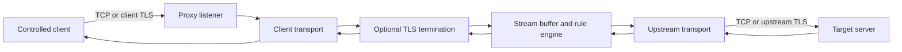

# PoC: TCP/TLS Proxy with Application-Data Filtering

## 1. Summary

Build a user-space TCP relay for server traffic that can make filtering decisions on reassembled application data, including plaintext exposed by a TLS termination point. The relay accepts client connections on a local or server-facing listen address, optionally terminates TLS, applies ordered content rules to the byte stream, and opens a separate upstream TCP/TLS connection to the real server.

This PoC is intentionally a proxy, not an extension of the existing WinDivert packet engine. WinDivert can match packet headers and individual payload bytes, but it does not reassemble an ordered TCP stream or decrypt TLS. A proxy is the correct ownership boundary for this behavior because it sees complete byte streams before encryption and after TLS termination.

The PoC must only be used for traffic and endpoints for which the operator is authorized to intercept and decrypt data. It must not attempt to bypass certificate validation or silently decrypt arbitrary third-party connections.

## 2. Problem and motivation

The current application delays, drops, and releases packets selected by WinDivert filters. Its filter inputs are packet-level values such as source/destination address, port, TCP flags, payload length, and payload bytes. This is sufficient for network simulation but insufficient for rules such as:

- block a request containing a particular application command;
- delay a response with a particular message type;
- reject a session after a protocol-level error;
- allow only a selected tenant, route, or operation in an encrypted protocol;
- inspect a complete length-prefixed message that spans multiple TCP segments.

TCP segmentation, retransmission, out-of-order delivery, buffering, and TLS record boundaries make packet-local matching unreliable. A TLS ciphertext packet also does not contain searchable application text. The relay must therefore operate on a logical stream or message boundary, not on individual packets.

## 3. Goals

The first PoC should demonstrate the complete path for one controlled TCP/TLS protocol:

1. Accept a client TCP connection.
2. Optionally perform server-side TLS termination using a configured certificate and private key.
3. Connect to the configured upstream server using TCP and, when enabled, upstream TLS.
4. Read both directions into bounded buffers.
5. Reassemble enough bytes to evaluate content rules across TCP and TLS record boundaries.
6. Apply a deterministic action: allow, drop, delay, close, or log.
7. Forward allowed bytes without changing their application-level representation.
8. Emit counters and structured logs that make each decision explainable.
9. Shut down cleanly without leaking sockets, TLS objects, or buffered data.

The PoC should support both of these useful modes:

- **Plain relay:** TCP to TCP, with filtering on plaintext application data.
- **TLS termination relay:** client TLS to proxy, plaintext filtering inside the proxy, and optional independent TLS from proxy to upstream.

## 4. Non-goals

The PoC does not initially attempt to:

- transparently intercept arbitrary existing client connections with WinDivert;
- decrypt TLS without endpoint configuration, a trusted test certificate, or application cooperation;
- support every TLS version, cipher, ALPN protocol, or application protocol;
- provide a production-grade certificate authority or certificate issuance service;
- infer message boundaries for an unknown protocol;
- modify the existing packet-mode behavior;
- provide high availability, clustering, authentication, or a management API;
- inspect encrypted bytes and claim they are equivalent to plaintext filtering.

## 5. Existing-code fit

The repository already has a clear packet-processing abstraction:

- `PacketEngine` owns WinDivert handles, packet receive/send threads, and lifecycle.
- `PacketMode::capture` receives one packet at a time and queues `PacketNode` objects.
- Profile filters are compiled as WinDivert expressions and operate at the network layer.
- The current Windows build uses C++20 and embeds the WinDivert runtime.

The proxy should initially be a separate component, for example `pocs/tcp_tls_proxy/`, with its own executable and configuration. Reusing `PacketMode` would obscure an important semantic difference: packet modes can delay or drop packets, while a stream proxy must preserve TCP ordering, flow control, and application framing. A later integration can share logging, profile parsing, or rule vocabulary after the standalone behavior is proven.

## 6. Proposed architecture



### 6.1 Components

**Listener**

- Binds an explicit address and port.
- Accepts connections and assigns a connection ID.
- Applies an allowlist for client addresses if configured.
- Creates one bidirectional session object per accepted connection.

**Transport adapters**

- `TcpTransport`: nonblocking socket read/write with bounded send and receive buffers.
- `TlsTransport`: TLS state machine layered over a TCP transport.
- Each direction has independent read, write, and shutdown state.

**TLS manager**

- Loads a configured server certificate and private key for client-facing TLS.
- Optionally validates the upstream certificate using the OS or configured trust store.
- Selects ALPN/SNI behavior explicitly.
- Exposes decrypted bytes only to the rule engine and never logs raw application data by default.

**Stream buffer**

- Maintains an ordered byte buffer per direction.
- Handles partial reads and writes, including a message split over many reads.
- Retains an overlap window so rules can match tokens split across evaluation boundaries.
- Enforces maximum buffered bytes and maximum time waiting for a complete message.

**Protocol framer**

- Converts a byte stream into filterable units when the protocol has a known framing format.
- The first adapter can support one documented test protocol, such as a 4-byte big-endian length prefix followed by a UTF-8 or binary message.
- A raw-stream fallback can evaluate bounded rolling windows, but it must not pretend that arbitrary byte matches are message-aware.

**Rule engine**

- Evaluates rules against direction, connection metadata, message bytes, and optional decoded fields.
- Returns one explicit action and a rule ID.
- Does not perform socket I/O, TLS operations, or unbounded buffering.

**Session controller**

- Coordinates both directions, rule decisions, delayed releases, half-close behavior, and fatal errors.
- Records state transitions and ensures one cleanup path for every exit.

**Metrics and logging**

- Counts accepted, rejected, active, completed, and failed connections.
- Counts bytes and messages in each direction.
- Counts rule matches by rule ID and action.
- Logs metadata such as connection ID, direction, rule ID, and lengths; payload logging is opt-in and redacted by default.

## 7. TLS model

TLS does not make plaintext available merely because the proxy sees packets. The proxy must be an endpoint in the TLS connection.

### 7.1 Client-facing TLS

For a controlled test client, configure the client to trust a test CA or a specific proxy certificate. The proxy presents a certificate whose name matches the configured service name, completes the TLS handshake, and receives decrypted application bytes.

The PoC should use a fixed certificate and key supplied by configuration. Automatic per-host certificate generation is deliberately deferred because it increases key-management and trust risks.

### 7.2 Upstream TLS

The proxy opens a separate TLS connection to the upstream server. Upstream certificate verification is enabled by default. The configuration may specify the expected server name for SNI and certificate verification. An insecure verification bypass must not be part of the normal path; a clearly labeled test-only option can be added only if the test environment requires it.

### 7.3 TLS limitations

- Filtering TLS ciphertext is not equivalent to filtering application data.
- TLS 1.3 encrypted records are opaque until the proxy terminates the client-side session.
- Certificate pinning, mutual TLS, custom key exchange, or application-level signatures may prevent a terminating relay from functioning.
- The proxy cannot preserve end-to-end TLS identity while also inspecting plaintext unless the application protocol provides a separate trusted inspection mechanism.
- Session resumption, early data, renegotiation, and post-handshake authentication should be disabled or rejected in the first PoC unless the selected TLS library handles them explicitly.

## 8. Rule and configuration design

Use a small, explicit configuration for the PoC. The following is illustrative and is not an immediate extension to `profiles/div1.yml` or the current parser:

```yaml
listen:
  address: 127.0.0.1
  port: 56000
  tls:
    enabled: true
    certificate: test-certs/service.crt
    private_key: test-certs/service.key
    client_ca: test-certs/test-ca.crt
    require_client_certificate: false

upstream:
  address: game.example.test
  port: 55000
  tls:
    enabled: true
    server_name: game.example.test
    verify_certificate: true

protocol:
  framing: u32be_length_prefix
  max_message_bytes: 1048576
  max_buffer_bytes: 4194304

rules:
  - id: block-admin-command
    direction: client_to_server
    match:
      field: command
      equals: ADMIN_RESET
    action: close

  - id: delay-selected-response
    direction: server_to_client
    match:
      field: event
      equals: ROUND_STARTED
    action:
      type: delay
      milliseconds: 500

  - id: observe-heartbeat
    direction: both
    match:
      field: command
      equals: HEARTBEAT
    action: log
```

Rules must be ordered and deterministic. The first matching rule wins. If no rule matches, the default action is `allow`.

Recommended initial match types:

- exact field equality after protocol decoding;
- bounded byte-prefix or byte-substring match;
- numeric comparison on a decoded field;
- direction and connection metadata predicates.

Avoid a general-purpose expression language in the first PoC. It would create a second parser and make security review harder before stream semantics are validated.

## 9. Action semantics

**Allow** forwards the complete framed unit in order.

**Log** forwards the unit and records metadata. It must not log payload bytes unless an explicit debug setting is enabled.

**Drop** consumes the unit and sends no replacement. The protocol-specific consequence must be documented because the peer may wait indefinitely.

**Delay** retains the unit for a bounded duration before forwarding it. Delays apply to framed units, not arbitrary packets, and the buffer limit remains active during the delay.

**Close** sends a protocol-appropriate error if one exists, then closes the affected session. The PoC should distinguish a rule rejection from a transport failure in logs and metrics.

The first implementation should not silently rewrite sequence numbers, retransmit data, or manufacture TCP acknowledgements. The operating system TCP stacks on each side of the proxy handle those concerns independently.

## 10. Data-flow and state machine

For each accepted connection:

1. Create a session ID and capture peer/local addresses.
2. Establish the upstream TCP connection with a connection timeout.
3. Complete client and upstream TLS handshakes, if configured.
4. Read bytes from either side when that side is ready.
5. Feed bytes through the appropriate TLS adapter and stream buffer.
6. Extract complete protocol frames subject to `max_message_bytes`.
7. Evaluate rules in the direction of travel.
8. Queue allowed or delayed frames for the opposite transport.
9. Drain writes while respecting backpressure.
10. Propagate orderly half-closes after buffered data is flushed.
11. On protocol, TLS, timeout, limit, or transport error, close both sides and record the reason.

A simple session state model is:

```text
Accepted
  -> ConnectingUpstream
  -> HandshakingClient / HandshakingUpstream
  -> Relaying
  -> Draining
  -> Closed
```

Any state can transition to `Closed` on a fatal error. A client handshake failure must not be reported as an upstream server failure, and vice versa.

## 11. Buffering, backpressure, and correctness

The proxy must treat memory limits as part of the protocol contract:

- `max_message_bytes` limits a single framed message.
- `max_buffer_bytes` limits queued data per direction and per session.
- `max_connections` limits concurrent sessions.
- `connect_timeout`, `handshake_timeout`, `idle_timeout`, and `action_delay_max` limit time spent in each phase.
- When a destination is slow, stop reading from the source rather than growing an unbounded queue.
- When a frame is delayed, continue enforcing the total buffer limit.
- Never forward bytes from a later frame before an earlier frame in the same direction.
- Preserve binary bytes exactly; do not assume UTF-8 unless the protocol definition says so.
- Treat malformed framing as a protocol error, not as a reason to scan unbounded input.

Use a single-threaded event loop for the first PoC if the selected Windows networking library supports it. A small number of worker threads is acceptable, but the ownership of each session and its buffers must remain clear. The existing packet engine's receive/send thread model should not be copied without a need for packet-level parallelism.

## 12. Security and privacy requirements

- Bind only to explicitly configured addresses; default to loopback for the PoC.
- Require an explicit upstream target; do not implement an open CONNECT-style proxy.
- Validate upstream certificates and hostnames by default.
- Protect private-key files with filesystem permissions and never print key material.
- Do not log plaintext payloads by default. If payload logging is enabled, cap length and redact configured fields.
- Make TLS termination visible in startup logs and status output.
- Require an explicit test setting for client certificate trust changes.
- Reject oversized frames and buffers before allocation.
- Avoid logging passwords, tokens, cookies, authorization headers, or private protocol fields.
- Document that TLS termination changes the trust boundary: the proxy can read and alter application data.
- Shut down by closing listeners, stopping new accepts, draining only bounded queues, and then destroying TLS objects and sockets.

## 13. Suggested implementation plan

### Phase 0: prove the environment

- Select a test protocol with a known frame format.
- Generate a local test CA, server certificate, and client trust configuration outside the application.
- Build a tiny client and upstream test server that can send split frames, coalesced frames, binary data, and deliberate delays.
- Decide on the TLS library available to the Windows C++20 build. OpenSSL or Schannel are candidates; the choice should be made before implementing the TLS adapter.

### Phase 1: plain TCP relay

- Add a standalone PoC executable under `pocs/tcp_tls_proxy/`.
- Implement listener, upstream connect, bidirectional copying, limits, timeouts, and clean shutdown.
- Add the protocol framer and an allow/log/close rule engine.
- Test messages split across reads and multiple messages received in one read.

### Phase 2: TLS on both legs

- Add client-facing TLS termination.
- Add upstream TLS with certificate and hostname verification.
- Test handshake failures, certificate failures, partial TLS records, and orderly shutdown.
- Confirm that rule matches operate on decrypted bytes and that ciphertext never reaches the rule engine.

### Phase 3: delay and operational visibility

- Add bounded framed-message delays.
- Add counters, rule IDs, connection IDs, and reason-coded close events.
- Add configuration validation and startup checks for certificate/key paths.
- Add a test-only payload trace with strict byte and field redaction.

### Phase 4: evaluate integration

Only after the standalone PoC is reliable, decide whether to share:

- logging primitives;
- configuration loading;
- server selection and profile activation concepts;
- rule and action naming.

Do not merge proxy stream logic into `PacketMode` merely to reuse profile names. If integration is desired, introduce a separate `TransportMode` or `ProxyEngine` abstraction with a clear stream-level contract.

## 14. Test plan and acceptance criteria

### Functional tests

- Plain TCP allow path forwards bytes byte-for-byte.
- TLS client-to-proxy-to-upstream path succeeds with a trusted test certificate.
- A rule matches a message split across at least three TCP reads.
- A rule matches a message whose bytes cross a TLS record boundary.
- Multiple frames in one read are evaluated independently and remain ordered.
- Client-to-server and server-to-client rules do not match the opposite direction.
- Delay action forwards after the configured duration and preserves ordering.
- Close action terminates the session with a rule-rejection reason.
- No-match traffic uses the configured default action.

### Failure and limit tests

- Invalid certificate, key, CA, and upstream hostname fail at startup or handshake with actionable errors.
- Upstream refusal and timeout close the client without hanging.
- Malformed length prefixes are rejected.
- Oversized frames and aggregate buffers are rejected before unbounded allocation.
- Slow readers apply backpressure and do not grow memory without limit.
- Client and upstream half-closes drain correctly.
- Abrupt resets free all session resources.
- The listener stops accepting and exits cleanly on shutdown.

### Acceptance criteria

The PoC is successful when a controlled TLS client sends a framed message whose bytes are split across TCP and TLS boundaries, the proxy matches the decoded content, performs the configured action, and produces a bounded, auditable log entry without logging the payload. An equivalent WinDivert packet filter must fail to provide that same result without an application protocol implementation, demonstrating why this is a separate transport-layer component.

## 15. Risks and open decisions

**TLS library:** Schannel aligns with native Windows certificate stores; OpenSSL may provide a more portable and familiar API. Select based on repository licensing, build integration, ALPN needs, and certificate-validation behavior.

**Protocol framing:** A generic stream proxy can only provide bounded byte-window matching. Reliable semantic filtering requires a protocol adapter, and each adapter becomes a maintenance and security surface.

**Connection identity:** The upstream server sees the proxy as the client unless the protocol carries original-client identity or the proxy uses a separate authenticated mechanism. This can affect authorization, rate limits, and auditing.

**Mutual TLS:** If the upstream requires the original client's certificate, the proxy needs an explicit credential-delegation design. Passing through the client's TLS identity is not automatic.

**Latency:** TLS termination, buffering, framing, and content decisions add latency. Measure handshake, steady-state throughput, p50/p95 rule latency, and memory per active session.

**Failure behavior:** Dropping application messages can leave a peer waiting for a response. Prefer protocol-level rejection or session close when the protocol cannot safely tolerate silent drops.

## 16. Recommended first slice

Implement a loopback-only, single-upstream relay for one length-prefixed test protocol with TLS on both legs. Support `allow`, `log`, `delay`, and `close`; omit arbitrary packet interception, certificate automation, and expression parsing. This slice proves the central claim: filtering decrypted, reassembled application data is reliable at the proxy boundary and is not something the current packet-mode abstraction can provide.
