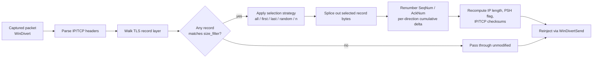
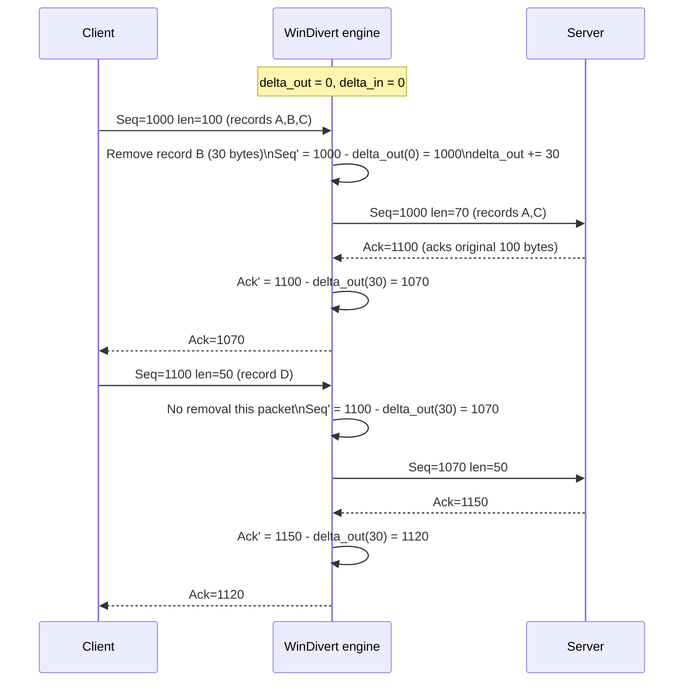
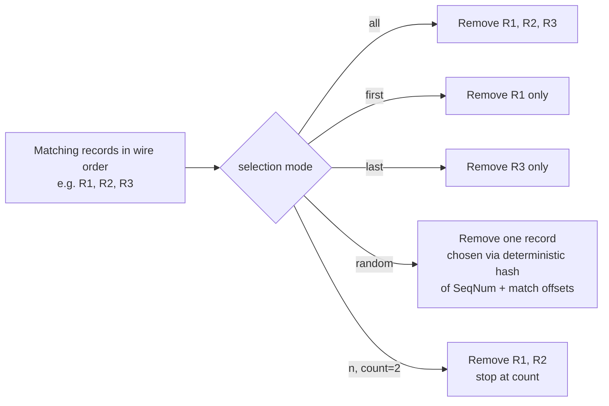

# PoC: TLS Record Segment Removal by Size Filter

## 1. Summary

Add a packet-mutation mode that inspects the TLS record layer inside a captured TCP payload, matches individual TLS records ("segments") against a size filter, and removes the matching records from the packet before it is reinjected. The mode never requires TLS decryption: the 5-byte TLS record header (content type, protocol version, record length) is always sent in the clear, even for encrypted application-data records, so record boundaries and sizes are fully visible to a WinDivert-level interceptor.

This is a packet-mutation feature, not a stream proxy. It fits the existing `PacketMode` model in [packet_engine.h](../include/packet_engine.h) and [packet_mode.h](../src/modules/packet_mode.h): one packet in, zero-or-one mutated packet out, with the same capture/queue/release pipeline already used by `drop`, `ratio`, and `hold_and_send`. It must only be used against traffic and endpoints the operator is authorized to intercept.



## 2. Terminology

- **Segment**: one TLS record as framed by the TLS record layer: `struct { uint8 type; uint16 legacy_record_version; uint16 length; opaque fragment[length]; }` (5-byte header + `length` bytes of fragment, `length` ≤ 16384 + 256 for TLS 1.3 or 16384 for TLS 1.2/1.0). "Segment size" in this document always means the *total* on-wire record size (`5 + length`), not the fragment length alone, unless a filter explicitly targets the fragment length.
- **Coalesced packet**: a single TCP segment (in the TCP/IP sense) whose payload contains more than one TLS record back-to-back, as observed repeatedly in the existing pcap analysis (e.g. `ServerHello` + `Certificate` + `ServerKeyExchange` + `ServerHelloDone` inside one 954-byte payload — see [division1_networking_architecture_pcap_analysis.md](../research/division1_networking_architecture_pcap_analysis.md)).
- **Straddled record**: a TLS record whose bytes are split across two or more TCP segments. This mode operates on one WinDivert-captured packet at a time and cannot see the rest of the byte stream, so straddled records are a hard limitation (see §7).
- **Removal**: excising a matched record's on-wire bytes from the packet's TCP payload, shrinking the packet, and repairing every affected header field so the result is still a well-formed IPv4/TCP packet.

## 3. Motivation

Existing modes (`drop`, `ratio`, `hold_and_send`, etc.) act on whole packets. Several coalesced TLS packets carry more than one logical message per packet (handshake messages during setup, and potentially multiple small application-data records once a session is established). A whole-packet drop is too coarse when only one record inside a coalesced packet is the target — dropping the packet also discards unrelated records, and (per §7) it is not equivalent to removing only the intended record's bytes.

A size-based filter is useful because:

- Ciphertext defeats content matching, but AEAD framing keeps a fixed per-plaintext-byte expansion (record length = plaintext length + explicit IV/tag/padding overhead depending on cipher suite), so a record's on-wire size is often a stable, decryption-free proxy for "what kind of message this probably is" (e.g. small fixed-size heartbeats/acks vs. larger state pushes), consistent with the size-based fingerprinting already used in [division1_networking_architecture_pcap_analysis.md](../research/division1_networking_architecture_pcap_analysis.md) (`34-byte` `17 03 03` application-data records observed repeatedly).
- It requires no protocol decoding beyond the public, unencrypted record header.

## 4. Goals

1. Parse the sequence of TLS records inside a single captured packet's TCP payload, without requiring TLS termination or key material.
2. Evaluate a compact, explicit filter syntax against each record's size.
3. Select which matching record(s) to remove according to a configurable selection strategy.
4. Produce a correctly re-framed IPv4/TCP packet: correct IP total length, correct TCP header length (unchanged), correct TCP/IP checksums, and a corrected `PSH` flag when the resulting payload is empty.
5. Make the sequence-number consequences of shrinking a live TCP stream an explicit, documented, and testable part of the design (see §8) rather than an afterthought.

## 5. Non-goals

- Decrypting or re-encrypting TLS application data.
- Handling records that straddle more than one captured packet (§7 documents the limitation and the safe fallback).
- Rewriting TLS handshake messages (`ClientHello`/`ServerHello`/certificates); the mode may still remove them by size, but it does not validate that doing so keeps the handshake state machine consistent — removing handshake records is expected to break the handshake and is primarily useful against already-established application-data traffic.
- Providing a general stream-rewriting proxy. If full correctness under retransmission and reordering turns out to require this, that is an explicit escalation point, not something this mode silently attempts (see §8.4).

## 6. Filter syntax

The filter is a single expression evaluated against the total on-wire size (`5 + length`) of one TLS record. Supported forms, in order of precedence in the grammar:

| Form | Meaning | Example |
|---|---|---|
| `N` | size equals `N` | `34` |
| `X..Y` | size in the inclusive range `[X, Y]` | `40..120` |
| `>X` | size strictly greater than `X` | `>512` |
| `<X` | size strictly less than `X` | `<64` |
| `>=X` | size greater than or equal to `X` | `>=1024` |
| `<=X` | size less than or equal to `X` | `<=48` |

Grammar (informal EBNF):

```text
filter      := clause ("," clause)*
clause      := exact | range | comparison
exact       := integer
range       := integer ".." integer
comparison  := ("<" | ">" | "<=" | ">=") integer
integer     := digit+          ; unsigned, 0..65540 (5 + max TLS record length)
```

Notes:

- A comma-separated `filter` is the union (logical OR) of its clauses; a record matches if it matches any clause. This mirrors the existing profile filter style of combining independent predicates (e.g. `disables` accepting a list) rather than inventing boolean operators.
- `X..Y` requires `X <= Y`; the loader must reject `Y < X` as a configuration error rather than silently matching nothing.
- Bounds are validated against the protocol's own record-size ceiling (16389 bytes for TLS 1.2/1.0's plaintext max, 16645 accounting for TLS 1.3 `content-type` byte and up to 255 bytes of padding) at load time so typos surface immediately instead of silently never matching.
- Whitespace around clauses and operators is trimmed by the loader; the stored/compiled form has none.
- There is no filter for record *content type* (handshake/alert/application-data/change-cipher-spec) in the first iteration; adding one is a natural, low-risk follow-up (§13) that composes with the size filter using the same comma-list-as-OR convention, or an explicit `type:` prefix if AND-composition with size is needed later.

### 6.1 Configuration shape

Proposed profile-level extension, additive to the existing `ProfileOptions`/`profiles.schema.json` shape and independent of `delay_mode` (a profile can combine packet-level delay/ratio behavior with segment removal, or use segment removal with `delay_mode: from_timestamp` and no additional delay):

```yaml
profiles:
  - name: "Strip small app-data records"
    key: k
    mode: toggle
    filter: "tcp.Psh and tcp.SrcPort == 55000"
    segment_removal:
      enabled: true
      size_filter: "34, 40..48, <32"
      selection: all        # all (default) | first | last | random | n
      count: 1               # required only when selection == n
```

`size_filter` and `selection`/`count` are validated the same way other profile fields are validated in `options.cc`/`profiles.schema.json`: reject unknown keys, reject `count` without `selection: n`, reject `count <= 0`.

## 7. Segment identification and the straddled-record limitation

For each captured packet with a non-empty TCP payload:

1. Parse the IPv4 and TCP headers with `WinDivertHelperParsePacket` (as already done throughout [packet_mode.cc](../src/modules/packet_mode.cc)) to get the payload pointer and length.
2. Walk the payload as a sequence of candidate TLS records: read `type` (1 byte), `version` (2 bytes), `length` (2 bytes, big-endian), then expect `length` bytes of fragment.
3. If the bytes remaining are fewer than 5, or a declared `length` would run past the end of the payload, treat the *remaining* bytes as an **unparsed tail**, not a record. The tail is left untouched by the size filter (it cannot be evaluated because its true size is unknown from this packet alone) and is never removed.
4. A payload that parses as zero complete records (e.g. plaintext pre-TLS control bytes, or the pre-TLS probe/challenge frames documented in [tcp_tls_proxy.md](tcp_tls_proxy.md#171-captured-protocol-lifecycle-overview)) is passed through unmodified — the segment filter only ever acts on payload that fully decodes as one or more TLS records.

```mermaid
flowchart TD
    Start([Start at payload offset 0]) --> Check{Bytes remaining\n>= 5?}
    Check -->|no| Tail[Remaining bytes = unparsed tail\nleft untouched]
    Check -->|yes| Hdr[Read type, version, length]
    Hdr --> Full{length bytes\nfit in payload?}
    Full -->|no| Tail
    Full -->|yes| Rec[Complete record found:\noffset, total size = 5 + length]
    Rec --> Filter{size matches\nsize_filter?}
    Filter -->|yes| Mark[Mark as candidate for removal]
    Filter -->|no| Keep[Keep record as-is]
    Mark --> Advance[Advance offset by 5 + length]
    Keep --> Advance
    Advance --> Check
    Tail --> Done([Done: candidate list + tail]))
```

This means:

- A packet whose payload is exactly one or more complete, non-straddled TLS records is fully eligible for filtering.
- A packet whose *last* record is truncated because the record continues in a later TCP segment only has its complete leading records evaluated; the truncated tail is preserved as-is and reattached after any removed leading records.
- A record that starts *before* the current packet (i.e., the current packet is a continuation of a record whose header appeared in an earlier packet) cannot be identified as a record at all from this packet in isolation, and the whole payload is treated as an unparsed tail and passed through.

Because coalescing is common at the start of a TLS session (handshake messages) but far from guaranteed in application-data traffic — a busy stream can just as easily split one record across two packets as it can coalesce several into one, depending on write sizes, Nagle/`TCP_NODELAY`, and MSS — **this mode is a best-effort, per-packet filter. It is not a substitute for a stream reassembler.** A production version that must reliably match every occurrence of a given record size regardless of TCP segmentation would need the reassembly machinery already scoped out in [tcp_tls_proxy.md](tcp_tls_proxy.md) (§6, "Stream buffer"), which is explicitly out of scope here.

## 8. Removal, re-framing, and sequence-number consequences

This is the part of the design that most needs to be correct, because it mutates a live, ordered, acknowledged byte stream. Two candidate strategies exist; only one is recommended for this PoC.

### 8.1 Strategy A (recommended): true splice with per-connection sequence renumbering

Removing a record's bytes shortens the TCP payload by exactly the record's total on-wire size. TCP sequence numbers count *bytes actually placed on the wire in this stream*, so once the engine ever sends a shorter payload than the original endpoint intended, every subsequent byte sent in that direction has effectively moved backward by the removed byte count relative to what the sender's stack believes it sent, and every ACK the *other* side later sends for bytes at-or-after the removed range references sequence space that no longer matches what this side is emitting.

Concretely, the engine must track, per connection and per direction, a running `delta` (bytes removed so far in that direction):

1. On the packet where a removal happens: shrink the payload, then rewrite the packet's own `SeqNum` by subtracting the *delta as it stood before this packet's removal* (i.e., the cumulative shift already committed for earlier packets), then increase `delta` by the newly removed byte count for all packets *after* this one.
2. On every later outbound packet in the same direction: subtract the current `delta` from `SeqNum` before sending.
3. On every inbound packet in the *reverse* direction: subtract the current `delta` from `AckNum` before sending, because the peer's ACK number acknowledges bytes numbered according to the original, un-shrunk stream, and this side's stack (and the real peer on the other physical connection, if this sits in front of a live server) must be kept consistent with the shrunk numbering it now emits.
4. SACK blocks (`TCP_OPT_SACK`) and timestamp echo fields are not currently rewritten by the existing packet engine and must either be stripped from affected packets or (preferred, smaller blast radius) the affected profile's filter should exclude connections using SACK, since a stale SACK block referencing pre-shrink sequence numbers is a correctness bug, not merely a cosmetic one.
5. `delta` must persist for the life of the connection once any removal has occurred on it, mirroring the per-direction state already kept in `PacketMode::last_sent_ack_`/`has_last_sent_ack_` (see [packet_mode.h](../src/modules/packet_mode.h)) — a new pair of `uint32_t` (or `uint64_t` to detect wraparound distinctly from the 32-bit sequence space) running totals per direction, reset in `PacketMode::reset()`.
6. Retransmissions of an *already-shrunk* original segment must be shrunk identically and deterministically (same filter, same selection outcome) so that a retransmission is byte-for-byte equal to the first transmission's shrunk form; this is why `selection: random` (§9) is unsafe under retransmission unless the random choice is derived deterministically from a stable retransmission key (e.g. original sequence number), not from a fresh RNG draw per capture.

This strategy keeps the stream byte-consistent from the receiver's point of view (it never sees a gap; it just sees a shorter stream than the sender's application layer believes it wrote), at the cost of needing full mid-connection sequence-space bookkeeping — effectively a lightweight, one-directional analogue of NAT sequence-number rewriting.



The diagram shows only the client-to-server direction accumulating a `delta`; the mirrored bookkeeping (`delta_in`) applies symmetrically if records are also removed server-to-client, in which case client-facing `AckNum`s for that direction are shifted instead.

### 8.2 Strategy B (rejected for this PoC): pad instead of shrink

An alternative is to keep every packet's length and sequence numbers unchanged and instead overwrite the removed record's bytes with a same-length filler, so no renumbering is ever needed. This is rejected because there is no generally safe filler:

- For TLS 1.2 and earlier, every record type is meaningful to the peer; a same-length record with fabricated content is either rejected outright (bad MAC/AEAD tag on an application-data or handshake record → immediate `bad_record_mac` fatal alert and connection teardown) or, if crafted as a valid-looking record of a different declared length, is exactly the "true splice" problem in a different shape.
- For TLS 1.3, a `change_cipher_spec` (content type `0x14`) record is a defined middlebox-compatibility no-op that a compliant TLS 1.3 stack silently ignores regardless of its contents — but it can only stand in for a removed record whose size exactly equals the replacement CCS record's size (a fixed 6 bytes: `14 03 03 00 01 01`), so it only covers the case of removing one very specific record size and does not generalize to "remove any record matching an arbitrary filter."
- Padding therefore only trivially works for the degenerate case of removing an entire record and replacing it with nothing further needed *and* the packet becoming empty — which strategy A already gives for free by shrinking to zero-length payload (§8.3) — so strategy B adds complexity without covering the general case.

Strategy B is recorded here as a rejected alternative, not pursued further, and should not be resurrected without first identifying a filler that is simultaneously (a) protocol-legal for every TLS version in scope and (b) constant-size-independent of the removed record's size.

### 8.3 The empty-payload case and the PSH flag

If a packet's payload, after removal, is empty — because it contained exactly one record and that record was removed, or because every record inside a coalesced packet matched and was removed — the resulting packet must not be sent as a zero-length `PSH, ACK` segment. `PSH` signals "deliver buffered bytes to the application now"; a packet asserting `PSH` with no payload is a harmless but nonsensical construction that some TCP stacks tolerate and others treat as suspicious. The mode therefore always clears `TCP_FLAG_PSH` (and only that flag) when it produces a zero-length payload, regardless of whether the original packet had one record or several, yielding a plain `ACK`. Existing flags (`ACK`, `URG`, `FIN`, `RST`, if any were set) are left untouched; `FIN`/`RST` packets are excluded from record parsing entirely (§8.5) because a FIN/RST payload, if any, is not a fresh TLS record stream.

If instead only *some* records inside a coalesced packet are removed, the remaining record(s) are copied into place contiguously, the payload length shrinks by the removed bytes, and `PSH` is preserved as-is (the packet still pushes real remaining data).

### 8.4 Recomputing headers

After the payload bytes are rewritten:

1. IPv4 `Total Length` is reduced by the removed byte count.
2. TCP header length (data offset) is unchanged — only the payload shrinks, not the TCP header/options.
3. `WinDivertHelperCalcChecksums` recomputes the IPv4 and TCP checksums exactly as the existing `ack_restoration` path already does after mutating `AckNum` in [packet_mode.cc](../src/modules/packet_mode.cc); the segment-removal path reuses the same call after all field rewrites (payload, `SeqNum`, `AckNum`, flags) are applied, not after each individual rewrite, to avoid recomputing checksums against an intermediate, inconsistent packet.
4. The `WINDIVERT_ADDRESS`/packet length passed to `WinDivertSend` must reflect the new, shorter length; the engine must not reuse the original captured length after shrinking the buffer.

### 8.5 Exclusions

Records are only ever considered inside packets that are pure application data carriers for this feature's purposes:

- Packets with `SYN`, `FIN`, or `RST` set are passed through unmodified — these are connection-lifecycle signals, and mutating their (often zero-length or lifecycle-only) payload has no well-defined meaning here.
- Packets with zero-length payload are passed through unmodified (nothing to parse).
- Out-of-order or already-duplicate packets (as already detected by `retransmission_mode`) should be filtered *before* segment removal runs, so the deterministic-retransmission requirement in §8.1 point 6 is checked against the same de-duplication the engine already performs.

## 9. Selection strategies

Once the size filter identifies the set of matching records within one packet, `selection` decides which of them are actually removed:

| `selection` | Behavior |
|---|---|
| `all` (default) | Remove every matching record. |
| `first` | Remove only the first matching record encountered in wire order; later matches in the same packet are left alone. |
| `last` | Remove only the last matching record encountered in wire order. |
| `random` | Remove exactly one matching record, chosen pseudo-randomly. Per §8.1 point 6, the "random" choice must be derived deterministically from stable per-packet material (e.g. a hash of `SeqNum` and the ordered list of matching record offsets) rather than a fresh RNG draw, so that a TCP retransmission of the identical original packet reproduces the identical removal instead of removing a different record and desynchronizing the renumbering state. |
| `n` | Remove up to `count` matching records (in wire order), requiring an explicit `count >= 1` in configuration; if fewer than `count` records match, all matches are removed and no error is raised. |

`selection` operates purely within the scope of records inside a single packet; it does not track "the 3rd matching record across the whole connection" — extending selection to a connection-wide budget (e.g. "remove only the first 5 matching records for the life of the connection") is a reasonable follow-up but requires connection-scoped state beyond what §8.1 already introduces, and is deferred (see §13).



## 10. Interaction with existing modes

- Segment removal is a payload-shaping step that should run before a profile's existing `delay_mode` (from_timestamp/ratio/hold_and_send/etc.) queues the packet, so delayed or ratio-selected packets are already in their final, re-framed form when they are queued and later released.
- `retransmission_mode` and `ack_restoration` operate on `SeqNum`/`AckNum` as already observed on the wire; once §8.1's renumbering is applied, these existing features naturally see the renumbered values and keep working unmodified, provided renumbering happens first in the per-packet pipeline.
- `subsequent_packet_hold_mode` matches held/subsequent packets by sequence/acknowledgment; because §8.1 keeps the stream'S numbering internally consistent (just shifted), this matching continues to work against the renumbered values.
- A profile combining segment removal with `windivert_options.forward` (WinDivert `NETWORK_FORWARD` layer, used for a router/gateway-style deployment) is the primary intended deployment shape, since forwarded traffic is not the local host's own TCP stack and this mode never needs to coordinate with a local socket's own sequence-number bookkeeping.

## 11. Security and correctness requirements

- Reject configuration where `size_filter` can never match anything (e.g. `X..Y` with `Y < X`, or a `<X`/`<=X` clause with `X <= 5`, since every record is at least 5 bytes) at load time.
- Reject `selection: n` without a positive `count`.
- Never mutate `SYN`/`FIN`/`RST` packets or zero-length payloads (§8.5).
- Never leave `PSH` set on a packet with an empty payload (§8.3).
- Never recompute checksums against a partially-mutated packet buffer — all field rewrites for a given packet happen before the single `WinDivertHelperCalcChecksums` call (§8.4).
- Never treat an unparsed tail (§7) as a record; never remove bytes whose true record boundary this packet cannot establish.
- Log, at debug level, every removal decision: connection tuple, direction, matched record offsets/sizes, selection outcome, and the resulting per-direction cumulative `delta`, mirroring the existing `LOG_DEBUG` style already used for retransmission/duplicate decisions in [packet_mode.cc](../src/modules/packet_mode.cc).
- Do not log TLS record *contents* by default (consistent with the payload-redaction stance already established in [tcp_tls_proxy.md](tcp_tls_proxy.md#12-security-and-privacy-requirements)); logging sizes and offsets is sufficient for debugging and does not risk exposing plaintext or ciphertext.

## 12. Test plan

### Functional

- Single-record packet, filter matches: payload becomes empty, `PSH` cleared, `ACK` remains, checksums valid, `SeqNum`/later-packet `SeqNum`s shifted by the removed size, peer-direction `AckNum`s shifted to match.
- Coalesced packet with 4 records (mirroring the `ServerHello`/`Certificate`/`ServerKeyExchange`/`ServerHelloDone` capture in [tcp_tls_proxy.md](tcp_tls_proxy.md#172-detailed-byte-by-byte-packet-dissection)), filter matches records 2 and 3 only, `selection: all`: resulting payload contains only records 1 and 4, contiguous, correctly length-adjusted.
- Same packet with `selection: first`, `last`, `random`, and `n: 1` each produce the documented single-record-removed result and remain stable across a simulated retransmission of the identical original packet.
- A record whose header is present but whose declared `length` runs past the captured payload (straddled) is left untouched; only the complete leading record(s), if any, are eligible for removal.
- A packet with a payload that fails to parse as any TLS record (plaintext pre-TLS control bytes) passes through unmodified.

### Sequence-consistency

- After several removals across multiple packets in one direction, cumulative `delta` correctly equals the sum of removed bytes, and a final packet's `SeqNum` plus its payload length still lands exactly where the next untouched packet's `SeqNum` (also shifted) expects.
- A reverse-direction `AckNum` observed after a forward-direction removal is shifted by the same `delta` and remains numerically consistent with the shifted forward stream.
- `retransmission_mode` correctly recognizes a retransmitted-and-reshrunk packet as a duplicate of the first shrunk transmission, not as a new distinct packet.

### Negative / configuration

- `size_filter` with an inverted range, a filter clause below the minimum 5-byte record size, or `selection: n` without `count` are all rejected at load time with an actionable error, consistent with existing schema validation in [profiles.schema.json](../schemas/profiles.schema.json).

## 13. Suggested implementation phases

### Phase 0: record parser and filter grammar

- Implement the standalone TLS record-boundary walker (type/version/length parsing, unparsed-tail detection) and the filter grammar (parse + validate + evaluate) as pure, unit-testable functions with no WinDivert dependency, alongside the existing modules in `src/modules/`.

### Phase 1: single-packet splice (no cross-packet renumbering)

- Wire the parser/filter into a new `PacketMode` (or an option on an existing one) that removes matching records and re-frames the packet (§8.3, §8.4), but only against a synthetic test harness with a single packet at a time, to validate framing/checksum correctness in isolation before introducing stateful renumbering.

### Phase 2: per-connection sequence/ack renumbering

- Add the per-direction cumulative `delta` state (§8.1) alongside the existing `last_sent_ack_`/`has_last_sent_ack_` state in `PacketMode`, and rewrite `SeqNum` (own direction) and `AckNum` (reverse direction) for every packet on an affected connection once removal has started.
- Validate against a live loopback TCP echo test with a scripted, coalesced-and-split TLS-record-shaped payload generator.

### Phase 3: selection strategies and deterministic retransmission behavior

- Implement `first`/`last`/`random`/`n`, with `random` derived deterministically as described in §9.
- Add a retransmission-simulation test that re-delivers an already-shrunk packet unmodified from the wire and confirms identical shrinkage is reproduced.

### Phase 4: profile schema, docs, and logging

- Extend `profiles.schema.json` and `ProfileOptions`/`options.cc` loading for `segment_removal` (§6.1).
- Add the debug logging described in §11.

## 14. Open questions

- Should a connection-wide removal budget (e.g. "remove at most N matching records for the life of the connection," beyond the per-packet `n` in §9) be added, and if so, does it share state with `disable_wait_ms`-style profile lifecycle tracking already in `ProfileOptions`?
- Should SACK options be actively stripped/rewritten on affected connections (§8.1 point 4) rather than requiring the operator to avoid SACK-using peers via filter scoping?
- Is a record content-type filter (handshake/alert/application-data/change-cipher-spec) needed before this is useful in practice, given that early-session traffic is dominated by handshake records this mode is not meant to target (§5)?
- Does this mode need its own PoC executable/harness under `pocs/`, similar to [tcp_tls_proxy/](tcp_tls_proxy/), for isolated testing before integrating into `PacketEngine`/`PacketMode` proper?
